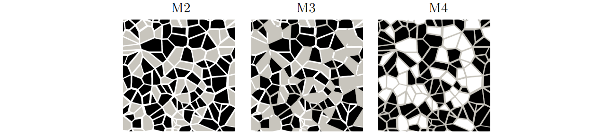
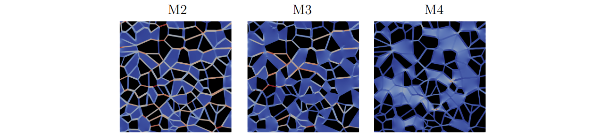

************************************************
Gray Multiscale Micromodels
************************************************

Extending the micromodel analysis performed in 
:doc:`../../../examples/SinglePhasePoreScale/Multiscale-Micromodel/Multiscale-Micromodel`
to the gray-scale, the micromodels M2, M3,
and M4 were simulated and compared with the experimental results of
:cite:t:`wolf2022dual`. These micromodels have square dimensions of
:math:`25 \times 25~\mathrm{mm}` and approximate depths of
:math:`34.8(0.9)~\mu\mathrm{m}`, :math:`33.6(0.5)~\mu\mathrm{m}`, and
:math:`32.0(2.9)~\mu\mathrm{m}` for models M2, M3, and M4, respectively.
The M0 micromodel is used to represent microporosity of the gray region in
the M2, M3, and M4 micromodels. :numref:`Fig. %s <MGX-Pore_struc>` illustrates the
micromodels' structure. The M0 values of permeability and porosity are
:math:`Da = k/H^{2} = 7.9 \times 10^{-8}` and :math:`\phi = 46.1\%`,
respectively. Each micromodel is characterized by its pore structure
described by:

* **Micromodel 2 (M2):** dual pore scale version of M1 with gray region
  represented by pore diameter ranging from 20 to :math:`50~\mu\mathrm{m}`,
  :math:`k = 10.06~\mathrm{Darcy}`, and :math:`\phi = 46.1\%`;

* **Micromodel 3 (M3):** dual pore scale version of M1 with gray region
  represented by pore diameter ranging from 20 to :math:`50~\mu\mathrm{m}`,
  :math:`k = 10.23~\mathrm{Darcy}`, and :math:`\phi = 46.1\%`;

* **Micromodel 4 (M4):** dual pore scale version of M1 with gray region
  represented by pore diameter ranging from 20 to :math:`50~\mu\mathrm{m}`,
  :math:`k = 10.79~\mathrm{Darcy}`, and :math:`\phi = 46.1\%`.

   Gray-scale micromodels based on the Voronoi tessellation: M2 - dual pore
   scale version with gray grains; M3 - dual pore scale version with gray
   grains and gray throats; M4 - dual pore scale version with voids and gray
   throats. The black, gray, and white colors represent the solid, porous
   continuous, and void regions, respectively.

Absolute Permeability - Numerical Setup
------------------------------------------------

To simulate the micromodels depicted in :numref:`Fig. %s <MGX-Pore_struc>`, the
geometries are discretized as described in :numref:`Tab. %s <Micro-Meshes-Gray-0>`.
The first and last mesh points along the :math:`y`- and :math:`x`-axes are
designated as solid, representing the walls of the micromodel. The fluid
flows through the :math:`z`-axis promoted by an external force.

.. list-table:: Gray micromodels mesh. The full-scale porosities are the same
   as those presented in the Absolute Permeability Section.
   :name: Micro-Meshes-Gray-0
   :header-rows: 1
   :align: center
   :widths: auto

   * - Model
     - Voxel size [:math:`\mu\mathrm{m}`]
     - Grid [:math:`x,y,z`]
     - :math:`\phi_{dig}` [%] Full-Scale
     - :math:`\phi_{dig}` [%] Gray-Scale
   * - M2
     - 5.00
     - :math:`5000 \times 5002 \times 9`
     - 40.2
     - 40.2
   * - M3
     - 4.86
     - :math:`5148 \times 5150 \times 9`
     - 33.6
     - 35.5
   * - M4
     - 4.57
     - :math:`5468 \times 5470 \times 9`
     - 36.7
     - 40.9

The observed difference between full-scale and gray-scale porosity in
:numref:`Tab. %s <Micro-Meshes-Gray-0>` for the M2 and M3 cases is an important aspect.
The fact that the gray porosity is greater implies that there are gray
points in the M2 and M3 cases which do not represent the REV porosity of the
M0 micromodel. Consequently, we believe that the presence of micro-scale
pore throats in the M2 and M3 cases results in porosity values that are
smaller than the REV porosity.

The ``lbpm_greyscale_simulator`` routine configuration for the gray
micromodel simulations is provided in ``file.db``, as demonstrated in the
code below, using the M2 model with a grid size of
:math:`5000 \times 5002 \times 9` as an example. The domain settings
``InletLayers = 0, 0, 5`` and ``OutletLayers = 0, 0, 5`` are used to connect
the inlet and outlet of the periodic domain.

.. code-block:: text

   Greyscale {
      tau = 0.8
      F = 0.0, 0.0, 1.0e-6
      timestepMax = 80000
      tolerance = 0.00001
      ComponentLabels = 1, 2 // Gray Scale
      PorosityList = 1.0, 0.461 // Porosity Scale
      PermeabilityList = 1.0e17, 9.92844538 // Permeability Scale
      collision = "MRT"
   }
   Domain {
      Filename = "M2-Gray-Micro-5000x5002x9.raw"
      ReadType = "8bit"      // data type
      N = 9, 5002, 5000     // size of original image
      nproc = 1, 2, 2        // process grid
      n = 9, 2501, 2500      // sub-domain size
      offset = 0, 0, 0 // offset to read sub-domain
      voxel_length = 5.0    // voxel length (in microns)
      ReadValues = 0, 1, 2   // labels within the original image
      WriteValues = 0, 1, 2  // associated labels to be used by LBPM
      InletLayers = 0, 0, 5 // specify 10 layers along the z-inlet
      OutletLayers = 0, 0, 5 // specify 10 layers along the z-inlet
      BC = 0                 // boundary condition type (0 for periodic)
   }
   Analysis {
      analysis_interval = 4000          // logging interval for timelog.csv
      subphase_analysis_interval = 80000  // loggging interval for subphase.csv
      visualization_interval = 80000    // interval to write visualization files
      N_threads = 1                      // number of analysis threads (GPU version only)
      restart_interval = 1000000         // interval to write restart file
      restart_file = "Restart"           // base name of restart file
   }
   Visualization {
      write_silo = true     // write SILO databases with assigned variables
      save_8bit_raw = true  // write labeled 8-bit binary files with phase assignments
      save_phase_field = true  // save phase field within SILO database
      save_pressure = true    // save pressure field within SILO database
      save_velocity = true    // save velocity field within SILO database
   }

Results
^^^^^^^

The results obtained are presented in :numref:`Fig. %s <MGX-Pore_R>` and
:numref:`Tab. %s <Micro-Gray-Perms-0>`. :numref:`Figure %s <MGX-Pore_R>` illustrates the velocity
magnitude field for each micromodel, while :numref:`Tab. %s <Micro-Gray-Perms-0>`
compares the obtained values with the full-scale results from
:numref:`Tab. %s <Microodels-Perm-0>` and the experimental results of
:cite:t:`wolf2022dual`.

   Velocity magnitude field obtained for each gray micromodel.

.. list-table:: Comparative Analysis of Permeability Values. The permeability
   results obtained using Gray-Scale models are compared with those from
   Full-Scale models and the experimental data reported by Wolf et al. (2022)
   for micromodels M2, M3, and M4. The values are expressed in Darcy units.
   :name: Micro-Gray-Perms-0
   :header-rows: 2
   :align: center
   :widths: auto

   * - Model
     - Gray-Scale
     -
     - Full-Scale
     -
     - :cite:t:`wolf2022dual`
   * -
     - :math:`k_{gs}` [Da]
     - :math:`\left\|\frac{k_{gs}-k_{exp}}{k_{exp}}100\right\|` [%]
     - :math:`k_{fs}` [Da]
     - :math:`\left\|\frac{k_{fs}-k_{exp}}{k_{exp}}100\right\|` [%]
     - :math:`k_{exp}` [Da]
   * - M2
     - 9.84
     - 25.67
     - 15.42
     - 16.46
     - 13.24(0.44)
   * - M3
     - 4.35
     - 24.21
     - 6.52
     - 13.58
     - 5.74(0.01)
   * - M4
     - 4.39
     - 23.12
     - 3.75
     - 34.32
     - 5.71(1.25)

In the comparative analysis of permeability values across different
micromodels, distinct variations were observed when contrasting the results
obtained from gray-scale, full-scale, and the experimental data reported by
:cite:t:`wolf2022dual`. For micromodel M2, the gray-scale approach yielded a
permeability value of :math:`9.84~\mathrm{Da}`, which was lower than the
:math:`15.42~\mathrm{Da}` obtained by the full-scale model. However, the
experimental result of :cite:t:`wolf2022dual` reached an intermediate
value, aligning more closely with the full-scale model. Similarly, for
micromodel M3, the gray-scale permeability was smaller than that of the
full-scale, and in percentage terms, it was more distant from the
experimental result. Regarding micromodel M4, the gray-scale model calculated
the permeability at :math:`4.39~\mathrm{Da}`, higher than the full-scale
estimation of :math:`3.75~\mathrm{Da}`. In relation to the experimental
results reported by :cite:t:`wolf2022dual`, the gray-scale model presented a
better percentage proximity. However, the porosity discrepancy for the
models M3 and M4 must be taken into account for relevant comparisons.
