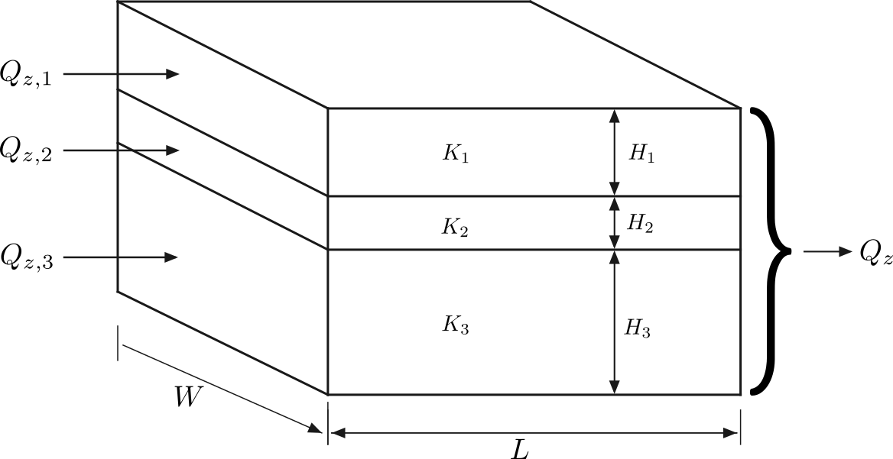
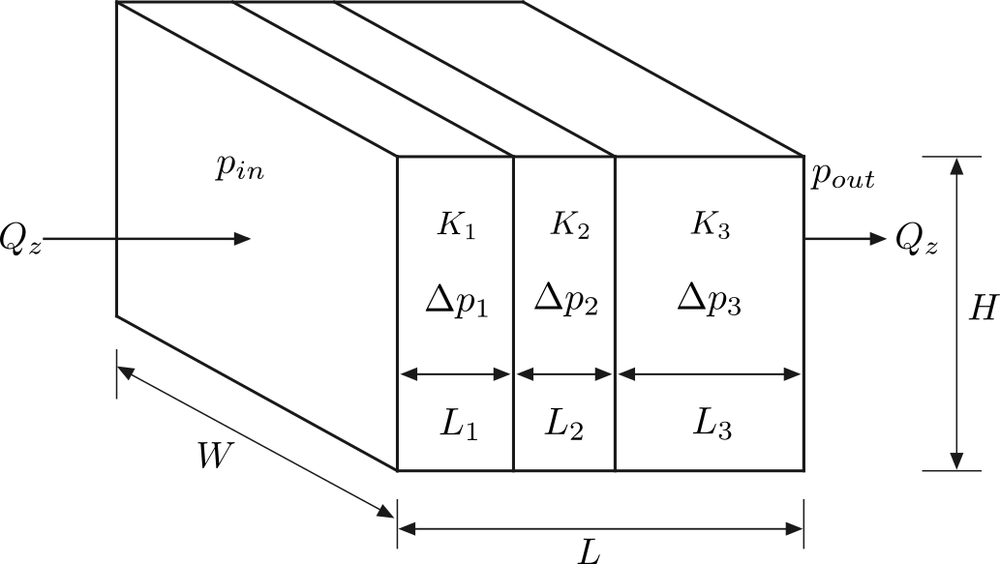

************************************************
Series and Parallel Porous Media Association
************************************************

This example examines parallel and series configurations to assess how 
permeability and porosity contrasts influence the macroscopic flow response. 
Numerical simulations are compared with analytical reference estimates, 
and the effects of nonlinear Forchheimer drag are evaluated.

---------------------------------------------------
Effective Permeability of Parallell Association
---------------------------------------------------

For a system consisting of :math:`n` porous layers arranged in parallel
to the flow direction, the effective permeability is commonly calculated
using the area-weighted arithmetic average:

.. math::

   \bar{K}_{D} = \frac{\displaystyle\sum_{i=1}^{n} K_i S_i}
   {\displaystyle\sum_{i=1}^{n} S_i} = \frac{\displaystyle\sum_{i=1}^{n} K_i h_i}
   {\displaystyle\sum_{i=1}^{n} h_i},

where :math:`K_i`, :math:`S_i`, and :math:`h_i` denote the intrinsic
permeability, cross-sectional area, and thickness of layer :math:`i`,
respectively. The second equality assumes that all layers have the same
width perpendicular to the flow direction.

This expression follows from Darcy's law when all layers are subjected
to the same macroscopic pressure gradient and interlayer viscous shear
effects are neglected. Although the porosity may differ between layers,
its influence is represented implicitly through the intrinsic
permeability :math:`K_i`. Consequently, this arithmetic average does
not explicitly account for momentum diffusion between adjacent layers.

To incorporate interlayer viscous coupling, we consider the steady-state
Darcy–Brinkman equation for unidirectional flow along the
:math:`x`-direction, with material properties varying only in the
transverse :math:`y`-direction.

Assuming incompressible flow, constant fluid density, and piecewise-constant
material properties within each layer, the governing equation is

.. math::

   \nu_{e,i}\frac{d^2u_i}{dy^2} - \frac{\nu\epsilon_i}{K_i}u_i + \epsilon_i G_x = 0, \qquad y_{i-1}\leq y\leq y_i,

where:

- :math:`u_i(y)` is the intrinsic (pore-averaged) fluid velocity in
  layer :math:`i`;
- :math:`\epsilon_i` is the porosity of layer :math:`i`;
- :math:`K_i` is the intrinsic permeability of layer :math:`i`;
- :math:`\nu` is the fluid kinematic viscosity;
- :math:`\nu_{e,i}` is the effective Brinkman kinematic viscosity
  in layer :math:`i`;
- :math:`G_x` is the imposed acceleration or equivalent pressure-gradient
  forcing per unit mass;
- :math:`y_i = \sum_{j=1}^{i}h_j` defines the upper boundary of layer
  :math:`i`, with :math:`y_0=0`.

For constant :math:`\epsilon_i`, :math:`K_i`, and :math:`\nu_{e,i}`
within each layer, the analytical solution is

.. math::

   u_i(y) = C_i\cosh\left[r_i(y-y_{i-1})\right] + D_i\sinh\left[r_i(y-y_{i-1})\right] + \frac{K_i}{\nu}G_x, \quad \text{where } r_i = \sqrt{\frac{\nu\epsilon_i}{\nu_{e,i}K_i}},

where :math:`C_i` and :math:`D_i` are integration constants determined
from the interface and boundary conditions. The total height of the 
layered system is :math:`H = \sum_{i=1}^{n}h_i`.

^^^^^^^^^^^^^^^^^^^^^^^^^^^^^^^^^^^
Interface and Boundary Conditions
^^^^^^^^^^^^^^^^^^^^^^^^^^^^^^^^^^^

At each internal interface :math:`y=y_i`, for
:math:`i=1,\ldots,n-1`, the following conditions are imposed.

**1. Continuity of intrinsic velocity**

.. math::

   u_i(y_i) = u_{i+1}(y_i).

This condition assumes that the intrinsic velocity is continuous
across the interface, consistent with the adopted Brinkman interface
model.

**2. Continuity of tangential viscous stress**

.. math::

   \nu_{e,i} \left.\frac{du_i}{dy}\right|_{y=y_i} = \nu_{e,i+1} \left.\frac{du_{i+1}}{dy}\right|_{y=y_i}.

For constant effective viscosity across all layers, this reduces to

.. math::

   \left.\frac{du_i}{dy}\right|_{y=y_i} = \left.\frac{du_{i+1}}{dy}\right|_{y=y_i}.

**3. Periodic boundary conditions**

To represent a periodically repeated arrangement of porous layers
in the transverse direction, periodic boundary conditions are
imposed at :math:`y=0` and :math:`y=H`:

.. math::

   u_1(0) = u_n(H) \quad \text{and }\quad \nu_{e,1} \left.\frac{du_1}{dy}\right|_{y=0} = \nu_{e,n} \left.\frac{du_n}{dy}\right|_{y=H}.

These conditions enforce periodicity of the intrinsic velocity and
continuity of tangential viscous stress across the periodic boundary.

^^^^^^^^^^^^^^^^^^^^^^^^^^^^^^^^^^^^^^^^^^^^^^^^^^
Determination of the Integration Constants
^^^^^^^^^^^^^^^^^^^^^^^^^^^^^^^^^^^^^^^^^^^^^^^^^^

For a system containing :math:`n` porous layers, the general solution
introduces :math:`2n` unknown integration constants:

.. math::

   \mathbf{c} = \begin{bmatrix} C_1 & D_1 & C_2 & D_2 & \cdots & C_n & D_n \end{bmatrix}^{T}.

The :math:`n-1` internal interfaces provide :math:`2(n-1)` equations,
while the two periodic boundary conditions provide two additional
equations.

Therefore, the complete system consists of :math:`2n` linear equations
for :math:`2n` unknown coefficients and can be expressed as

.. math::

   \mathbf{M}\mathbf{c} = \mathbf{b}.

The integration constants can be obtained using standard linear
algebra methods, allowing the velocity profile in each porous layer
to be reconstructed analytically.

^^^^^^^^^^^^^^^^^^^^^^^^^^^^^^^^^^^^^^^^^^^^^^^^^^
Three Layers (:math:`n=3`) Parallel Association
^^^^^^^^^^^^^^^^^^^^^^^^^^^^^^^^^^^^^^^^^^^^^^^^^^

To assess the model's ability to capture viscous shear and momentum transfer
between adjacent porous media, a configuration comprising three porous layers
arranged parallel to the flow direction was considered. The computational
domain extends 50 voxels along the flow direction and contains three layers
stacked in the transverse direction, with thicknesses of 20, 50, and 30 voxels,
respectively, giving a total height of 100 voxels
(:numref:`Fig. %s <parallel-schematic>`).

The layers were assigned permeabilities of
:math:`K_1 = 100.0 \ \mu\text{m}^2`,
:math:`K_2 = 250.0 \ \mu\text{m}^2`, and
:math:`K_3 = 500.0 \ \mu\text{m}^2`, with corresponding porosities of
:math:`\epsilon_1 = 0.2`, :math:`\epsilon_2 = 0.3`, and
:math:`\epsilon_3 = 0.4`. The simulations used a spatial resolution of
:math:`0.5 \ \mu\text{m}/\text{voxel}`, a relaxation time of
:math:`\tau \approx 0.933`, and a uniform body force of magnitude
:math:`10^{-8}` in lattice units, applied along the flow direction.

   Schematic of three porous layers arranged parallel to the flow direction.

Porosity and permeability were assigned using two methods configured in
``input.db``: label-based property lists and voxelwise property maps.
The Python functions used to generate the geometry, layer labels, and
property maps are provided in the expandable section below.

.. raw:: html

   

   
<b>Click to expand:Python Code to Generate the Parallel Association Geometry</b>

.. code-block:: python

   import os
   import numpy as np

   def generate_geometry_raw(
       length: int, height: tuple[int, int, int], output_dir: str
   ) -> None:
       """Generates the geometry matrix in uint8 format."""
       total_height = sum(height)
       shape = (length, total_height, length)
       geometry = np.ones(shape, dtype=np.uint8)

       filepath = os.path.join(output_dir, "input.raw")
       geometry.tofile(filepath)

   def generate_labels_raw(
       length: int, height: tuple[int, int, int], output_dir: str
   ) -> None:
       """Generates the labels matrix in uint8 format for multiple layers."""
       total_height = sum(height)
       shape = (length, total_height, length)
       labels = np.zeros(shape, dtype=np.uint8)

       h0, h1, h2 = height

       labels[:, :h0, :] = 1
       labels[:, h0 : h0 + h1, :] = 2
       labels[:, h0 + h1 :, :] = 3

       filepath = os.path.join(output_dir, "labels.raw")
       labels.tofile(filepath)

   def generate_permeability_raw(
       length: int,
       height: tuple[int, int, int],
       permeability: tuple[float, float, float],
       output_dir: str,
   ) -> None:
       """Generates the permeability matrix in float64 format."""
       total_height = sum(height)
       shape = (length, total_height, length)
       permeability_matrix = np.zeros(shape, dtype=np.float64)

       h0, h1, h2 = height
       k0, k1, k2 = permeability

       permeability_matrix[:, :h0, :] = k0
       permeability_matrix[:, h0 : h0 + h1, :] = k1
       permeability_matrix[:, h0 + h1 :, :] = k2

       filepath = os.path.join(output_dir, "permeability.raw")
       permeability_matrix.tofile(filepath)

   def generate_porosity_raw(
       length: int,
       height: tuple[int, int, int],
       porosity: tuple[float, float, float],
       output_dir: str,
   ) -> None:
       """Generates the porosity matrix in float64 format."""
       total_height = sum(height)
       shape = (length, total_height, length)
       porosity_matrix = np.zeros(shape, dtype=np.float64)

       h0, h1, h2 = height
       phi0, phi1, phi2 = porosity

       porosity_matrix[:, :h0, :] = phi0
       porosity_matrix[:, h0 : h0 + h1, :] = phi1
       porosity_matrix[:, h0 + h1 :, :] = phi2

       filepath = os.path.join(output_dir, "porosity.raw")
       porosity_matrix.astype(np.float64).tofile(filepath)

.. raw:: html

   

Four cases were simulated by combining the two property-assignment methods
with Forchheimer drag either disabled or enabled.
:numref:`Table %s <parallel-results>` compares the numerical results with the
analytical Darcy–Brinkman solution, which excludes nonlinear Forchheimer drag.

With Forchheimer drag disabled, both methods yield an effective permeability
of :math:`251.680 \ \mu\text{m}^2`, differing from the analytical value of
:math:`251.660 \ \mu\text{m}^2` by approximately :math:`0.008\%`.
Enabling Forchheimer drag reduces the apparent permeability to
:math:`248.360 \ \mu\text{m}^2`, approximately :math:`1.31\%` below the linear
analytical reference. Both property-assignment methods give the same results
to the precision reported, and the volume-averaged porosity is
:math:`0.310` in all cases.

.. list-table:: Mean porosity and permeability of the parallel-layer configuration.
   :name: parallel-results
   :header-rows: 1
   :widths: auto
   :align: center

   * - Case
     - Mode
     - Forchheimer
     - Porosity
     - Permeability [ :math:`\mu\text{m}^2` ]
   * - **Analytical**
     - Math
     - False
     - 0.310
     - 251.660
   * - **Case 1**
     - Labels
     - False
     - 0.310
     - 251.680
   * - **Case 2**
     - Files
     - False
     - 0.310
     - 251.680
   * - **Case 3**
     - Labels
     - True
     - 0.310
     - 248.360
   * - **Case 4**
     - Files
     - True
     - 0.310
     - 248.360

An example ``input.db`` for the present configuration is provided below.

.. raw:: html

   

   
<b>Click to expand: Parallel Association Example of Input.db file</b>

.. code-block:: text

   Greyscale {
       tau = 0.9330127
       F = 0.0, 0.0, 1e-08
       timestepMax = 1000000
       tolerance = 1e-12
       collision = "MRT"
       Forchheimer = false
       ComponentLabels = 1, 2, 3               // not necessary for file aproach
       PorosityList = 0.2, 0.3, 0.4            // or FileVoxelPorosityMap = "porosity.raw", "double"
       PermeabilityList = 100.0, 250.0, 500.0  // or FileVoxelPermeabilityMap = "permeability.raw", "double"
   }

   Domain {
       Filename = "input.raw"  // or "label.raw"
       ReadType = "8bit"
       offset = 0, 0, 0
       voxel_length = 0.5
       N = 50, 100, 50
       nproc = 1, 1, 1
       n = 50, 100, 50
       ReadValues = 0, 1, 2, 3
       WriteValues = 0, 1, 2, 3
       InletLayers = 0, 0, 0
       OutletLayers = 0, 0, 0
       BC = 0
   }

   Visualization {
       format = "vtk"
       write_silo = true
       save_8bit_raw = false
       save_phase_field = true
       save_pressure = true
       save_velocity = true
   }

   Analysis {
       analysis_interval = 1000
       subphase_analysis_interval = 5000
       visualization_interval = 1000000
       N_threads = 1
       restart_interval = 1000000
       restart_file = "Restart"
   }

.. raw:: html

   

---------------------------------------------
Effective Permeability of Series Association
---------------------------------------------

For a system consisting of :math:`n` porous layers arranged in
series along the flow direction, the effective permeability is
commonly calculated using the length-weighted harmonic average:

.. math::

   K_{eq} = \frac{\displaystyle\sum_{i=1}^{n}L_i} {\displaystyle\sum_{i=1}^{n}\frac{L_i}{K_i}}.

where :math:`L_i` and :math:`K_i` denote the length and intrinsic
permeability of layer :math:`i`, respectively.

This expression follows from Darcy's law under steady-state,
incompressible, one-dimensional flow conditions, assuming a constant
cross-sectional area and negligible additional interfacial
hydraulic resistance. Although the porosity may vary between layers, its influence is
implicitly represented through the intrinsic permeability
:math:`K_i`. Consequently, the harmonic average remains applicable
to porous media with variable porosity, provided that Darcy's law
is valid within each layer.

^^^^^^^^^^^^^^^^^^^^^^^^^
Conservation of Mass
^^^^^^^^^^^^^^^^^^^^^^^^^

For steady-state, incompressible, one-dimensional flow, conservation
of mass requires

.. math::

   \frac{d}{dx}\left(\epsilon u\right)=0,

where :math:`u` is the intrinsic (pore-averaged) velocity and
:math:`\epsilon` is the porosity.

Consequently, the superficial (Darcy) velocity remains constant:

.. math::

   q = \epsilon_i u_i = \bar{q}.

Therefore, for layers with different porosities, the intrinsic
velocity is given by

.. math::

   u_i = \frac{\bar{q}}{\epsilon_i}.

Thus, the intrinsic velocity generally varies between layers,
while the superficial velocity remains constant.

^^^^^^^^^^^^^^^^^^^^^^^^^
Effective Permeability
^^^^^^^^^^^^^^^^^^^^^^^^^

Starting from the steady-state Darcy-Brinkman equation for unidirectional flow driven by a constant
effective force :math:`G_x`:

.. math::

   \nu_e\frac{d^2u}{d y^2} - \frac{\nu \epsilon}{ K} u + \epsilon G_x = 0

Since the velocity is uniform (:math:`u(y) = \bar{u}`), the viscous shear term vanishes
(:math:`\frac{d^2u}{dy^2} = 0`). Assuming constant properties for each porous medium, we integrate
the remaining terms along the :math:`x`-axis to represent the macroscopic momentum balance over the
entire length :math:`L`:

.. math::

   \int_0^L \left(\epsilon G_x - \frac{\epsilon \nu}{K} \bar{u} \right) dx = \sum_{i=1}^n \left[ \int_{x_{i-1}}^{x_i} \left(\epsilon G_x - \frac{\epsilon \nu}{K} \bar{u} \right) dx \right] = 0

Evaluating the integral for the piecewise constant properties yields:

.. math::

   \sum_{i=1}^n \left( \epsilon_i G_x L_i - \frac{\epsilon_i \nu}{K_i} \bar{u} L_i \right) = 0

Rearranging the terms to isolate the uniform velocity and effective force relationship:

.. math::

   \bar{u} \nu \sum_{i=1}^n \left( \frac{\epsilon_i L_i}{K_i} \right) = G_x \sum_{i=1}^n \left( \epsilon_i L_i \right)

This yields the equivalent permeability:

.. math::

   K_{eq} = \frac{\sum_{i=1}^n \left( \epsilon_i L_i \right)}{\sum_{i=1}^n \left( \frac{\epsilon_i L_i}{K_i} \right)}

^^^^^^^^^^^^^^^^^^^^^^^^^^^^^^^^^^^^^^^^^^^^^^^^^^
Three Layers (:math:`n=3`) Series Association
^^^^^^^^^^^^^^^^^^^^^^^^^^^^^^^^^^^^^^^^^^^^^^^^^^

To assess the model's accuracy in predicting the effective macroscopic
permeability of porous media arranged in series, a configuration comprising
three consecutive porous layers was considered. The layers extend along
the flow direction, with lengths of 15, 50, and 25 voxels, respectively,
giving a total domain length of 90 voxels. All layers share a
:math:`50 \times 50`-voxel cross section
(:numref:`Fig. %s <series-schematic>`).

The layers were assigned permeabilities of
:math:`K_1 = 100.0 \ \mu\text{m}^2`,
:math:`K_2 = 250.0 \ \mu\text{m}^2`, and
:math:`K_3 = 500.0 \ \mu\text{m}^2`, with corresponding porosities of
:math:`\epsilon_1 = 0.2`, :math:`\epsilon_2 = 0.3`, and
:math:`\epsilon_3 = 0.4`. The simulations used a spatial resolution of
:math:`0.5 \ \mu\text{m}/\text{voxel}`, a relaxation time of
:math:`\tau \approx 0.933`, and a uniform driving force of magnitude
:math:`10^{-8}` in lattice units, applied along the
:math:`z`-direction. All simulations were run using four MPI processes.

   Schematic of three porous layers arranged in series along the flow direction.

Porosity and permeability were assigned using two methods configured in
``input.db``: label-based property lists and voxelwise property maps.
The Python functions used to generate the geometry, layer labels, and
property maps are provided in the expandable section below.

.. raw:: html

   

   
<b>Click to expand: Python Code to Generate the Series Association Geometry</b>

.. code-block:: python

   import os
   import numpy as np

   def generate_geometry_raw(
       length: tuple[int, int, int], height: int, output_dir: str
   ) -> None:
       """Generates the geometry matrix in uint8 format.

       The porous medium is assigned a value of 1 throughout the entire domain.

       Args:
           length: A tuple containing the lengths of the three layers along the x-axis.
           height: The height and width of the domain (y and z axes).
           output_dir: The directory where the file will be saved.
       """
       total_length = sum(length)
       shape = (total_length, height, height)
       geometry = np.ones(shape, dtype=np.uint8)

       filepath = os.path.join(output_dir, "input.raw")
       geometry.tofile(filepath)

   def generate_labels_raw(
       length: tuple[int, int, int], height: int, output_dir: str
   ) -> None:
       """Generates the labels matrix in uint8 format for multiple layers in series.

       Assigns a distinct integer label (1, 2, 3) to each horizontal layer along
       the flow direction (x-axis).

       Args:
           length: A tuple containing the lengths of the three layers along the x-axis.
           height: The height and width of the domain (y and z axes).
           output_dir: The directory where the file will be saved.
       """
       total_length = sum(length)
       shape = (total_length, height, height)
       labels = np.zeros(shape, dtype=np.uint8)

       l0, l1, l2 = length

       labels[:l0, :, :] = 1
       labels[l0 : l0 + l1, :, :] = 2
       labels[l0 + l1 :, :, :] = 3

       filepath = os.path.join(output_dir, "labels.raw")
       labels.tofile(filepath)

   def generate_permeability_raw(
       length: tuple[int, int, int],
       height: int,
       permeability: tuple[float, float, float],
       output_dir: str,
   ) -> None:
       """Generates the permeability matrix in float64 format.

       Fills each layer in series with its respective macroscopic permeability value.

       Args:
           length: A tuple containing the lengths of the three layers along the x-axis.
           height: The height and width of the domain (y and z axes).
           permeability: A tuple containing the permeability values for each layer.
           output_dir: The directory where the file will be saved.
       """
       total_length = sum(length)
       shape = (total_length, height, height)
       permeability_matrix = np.zeros(shape, dtype=np.float64)

       l0, l1, l2 = length
       k0, k1, k2 = permeability

       permeability_matrix[:l0, :, :] = k0
       permeability_matrix[l0 : l0 + l1, :, :] = k1
       permeability_matrix[l0 + l1 :, :, :] = k2

       filepath = os.path.join(output_dir, "permeability.raw")
       permeability_matrix.tofile(filepath)

   def generate_porosity_raw(
       length: tuple[int, int, int],
       height: int,
       porosity: tuple[float, float, float],
       output_dir: str,
   ) -> None:
       """Generates the porosity matrix in float64 format.

       Fills each layer in series with its respective macroscopic porosity fraction.

       Args:
           length: A tuple containing the lengths of the three layers along the x-axis.
           height: The height and width of the domain (y and z axes).
           porosity: A tuple containing the porosity values for each layer.
           output_dir: The directory where the file will be saved.
       """
       total_length = sum(length)
       shape = (total_length, height, height)
       porosity_matrix = np.zeros(shape, dtype=np.float64)

       l0, l1, l2 = length
       phi0, phi1, phi2 = porosity

       porosity_matrix[:l0, :, :] = phi0
       porosity_matrix[l0 : l0 + l1, :, :] = phi1
       porosity_matrix[l0 + l1 :, :, :] = phi2

       filepath = os.path.join(output_dir, "porosity.raw")
       porosity_matrix.tofile(filepath)

.. raw:: html

   

Four cases were simulated by combining the two property-assignment methods
with Forchheimer drag either disabled or enabled.
:numref:`Table %s <series-results>` compares the numerical results with the
analytical reference obtained from the porosity-weighted expression
introduced above, which excludes nonlinear Forchheimer drag.

With Forchheimer drag disabled, both methods yield an effective permeability
of :math:`254.550 \ \mu\text{m}^2`, differing from the reported analytical
reference of :math:`254.545 \ \mu\text{m}^2` by approximately
:math:`0.002\%`. Enabling Forchheimer drag reduces the apparent permeability
to :math:`251.120 \ \mu\text{m}^2`, approximately :math:`1.35\%` below the
linear reference. Both property-assignment methods give the same results
to the precision reported. The volume-averaged porosity is approximately
:math:`0.311` in all cases.

.. list-table:: Mean porosity and permeability of three porous layers in series.
   :name: series-results
   :header-rows: 1
   :align: center
   :widths: 12 12 15 14 24

   * - Case
     - Mode
     - Forchheimer
     - Porosity
     - Permeability [ :math:`\mu\text{m}^2` ]
   * - **Analytical**
     - Math
     - False
     - 0.311
     - 254.545
   * - **Case 1**
     - Labels
     - False
     - 0.311
     - 254.550
   * - **Case 2**
     - Files
     - False
     - 0.311
     - 254.550
   * - **Case 3**
     - Labels
     - True
     - 0.311
     - 251.120
   * - **Case 4**
     - Files
     - True
     - 0.311
     - 251.120

An example ``input.db`` configuration is provided in the expandable

.. raw:: html

   

   
<b>Click to expand: Series Association Example of Input.db file</b>

.. code-block:: text

   Greyscale {
       tau = 0.9330127
       F = 0.0, 0.0, 1e-08
       timestepMax = 1000000
       tolerance = 1e-12
       collision = "MRT"
       Forchheimer = false
       ComponentLabels = 1, 2, 3               // not necessary for file aproach
       PorosityList = 0.2, 0.3, 0.4            // or FileVoxelPorosityMap = "porosity.raw", "double"
       PermeabilityList = 100.0, 250.0, 500.0  // or FileVoxelPermeabilityMap = "permeability.raw", "double"
   }

   Domain {
       Filename = "input.raw"   // or "label.raw"
       ReadType = "8bit"
       offset = 0, 0, 0
       voxel_length = 0.5
       N = 50, 50, 90
       nproc = 2, 1, 2
       n = 25, 50, 45
       ReadValues = 0, 1, 2, 3
       WriteValues = 0, 1, 2, 3
       InletLayers = 0, 0, 0
       OutletLayers = 0, 0, 0
       BC = 0
   }

   Visualization {
       format = "vtk"
       write_silo = true
       save_8bit_raw = false
       save_phase_field = true
       save_pressure = true
       save_velocity = true
   }

   Analysis {
       analysis_interval = 1000
       subphase_analysis_interval = 5000
       visualization_interval = 1000000
       N_threads = 1
       restart_interval = 1000000
       restart_file = "Restart"
   }

.. raw:: html

   

