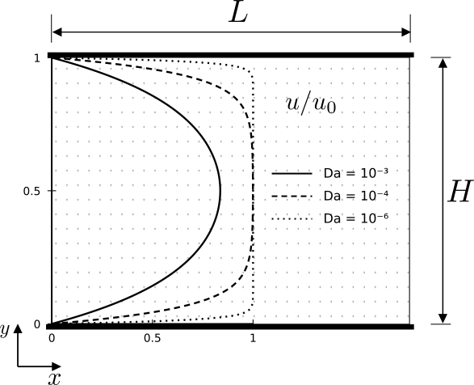

************************************************
Grayscale Poiseuille Flow
************************************************

Starting from the two-dimensional, steady-state Darcy–Brinkman equation for 
unidirectional flow along the :math:`x`-direction, driven by a constant body 
force (:math:`g`) and an imposed pressure gradient, we consider a homogeneous porous 
medium characterized by constant porosity, permeability, and effective viscosity. 
The velocity varies only in the transverse :math:`y`-direction. The governing equation 
is given by:

.. math::

   \nu_e \frac{d^2u}{dy^2} - \frac{\nu \epsilon}{K} u
   + \epsilon \left(g - \frac{1}{\rho}\frac{\partial p}{\partial x}\right) = 0

Letting the effective driving force be:

.. math::

   G_x = g - \frac{1}{\rho}\frac{\partial p}{\partial x}

The general solution for the velocity profile :math:`u(y)` for a given medium
is expressed using hyperbolic functions:

.. math::

   u(y) = A \cosh(ry) + B \sinh(ry) + \frac{K}{\nu}G_x,
   \qquad r = \sqrt{\frac{\nu \epsilon}{\nu_e K}}

Here, the coefficients :math:`A` and :math:`B` are determined by applying
specific boundary conditions. For Poiseuille flow within a single porous
medium confined between two stationary impermeable plates located at
:math:`y = 0` and :math:`y = H`, the no-slip condition applies:
:math:`u(0) = 0` and :math:`u(H) = 0`.

Applying these conditions to the general solution yields the coefficients
:math:`A` and :math:`B`. The resulting velocity profile is:

.. math::

   u(y) = \frac{K G_x}{\nu}
   \left(1 - \frac{\cosh\left[r\left(y - \frac{H}{2}\right)\right]}
   {\cosh\left(\frac{rH}{2}\right)}\right)

The mean velocity is calculated as:

.. math::

   \bar{u} = \frac{1}{H} \int_0^H u(y)\,dy
   = \frac{K G_x}{\nu}
   \left[1 - \frac{2}{rH}\tanh\left(\frac{rH}{2}\right)\right]

Consequently, the equivalent permeability for Poiseuille flow is:

.. math::

   K_{eq} = K
   \left[1 - \frac{2}{rH}\tanh\left(\frac{rH}{2}\right)\right]

----------------------------
Validation setup and results
----------------------------

To assess the model's accuracy in predicting flow through a homogeneous
porous medium confined between two stationary impermeable walls, a
Poiseuille flow benchmark was considered. The computational domain is
50 voxels long, 50 voxels wide, and 102 voxels high. Its height comprises
a 100-voxel porous region bounded by two solid wall planes, each one
voxel thick (:numref:`Fig. %s <poiseuille-schematic>`).

The porous region was assigned a uniform porosity of
:math:`\epsilon = 0.3` and an intrinsic permeability of
:math:`K = 250.0 \ \mu\text{m}^2`. The simulations used a spatial
resolution of :math:`0.5 \ \mu\text{m}/\text{voxel}`, a relaxation time
of :math:`\tau \approx 0.933`, and a uniform body force of magnitude
:math:`10^{-8}` in lattice units, applied along the
:math:`z`-direction.

   Schematic of Poiseuille flow through a homogeneous porous medium
   confined between two impermeable walls.

Porosity and permeability were assigned using two methods configured
in ``input.db``: label-based property lists and voxelwise property maps.
The Python functions used to generate the geometry and property maps
are provided in the expandable section below.

.. raw:: html

   

   
<b>Click to expand:Python Code to Generate Grayscale Poiseuille Geometry</b>

.. code-block:: python

   import os
   import numpy as np

   def generate_geometry_raw(length: int, height: int, output_dir: str) -> None:
       shape = (length, height + 2, length)
       geometry = np.ones(shape, dtype=np.uint8)

       geometry[:, 0, :] = 0
       geometry[:, -1, :] = 0

       filepath = os.path.join(output_dir, "input.raw")
       geometry.tofile(filepath)

   def generate_permeability_raw(
       length: int, height: int, permeability: float, output_dir: str
   ) -> None:
       shape = (length, height + 2, length)
       permeability_matrix = np.full(shape, permeability, dtype=np.float64)

       permeability_matrix[:, 0, :] = 0.0
       permeability_matrix[:, -1, :] = 0.0

       filepath = os.path.join(output_dir, "permeability.raw")
       permeability_matrix.tofile(filepath)

   def generate_porosity_raw(
       length: int, height: int, porosity: float, output_dir: str
   ) -> None:
       shape = (length, height + 2, length)
       porosity_matrix = np.full(shape, porosity, dtype=np.float64)

       porosity_matrix[:, 0, :] = 0.0
       porosity_matrix[:, -1, :] = 0.0

       filepath = os.path.join(output_dir, "porosity.raw")
       porosity_matrix.tofile(filepath)

.. raw:: html

   

Four cases were simulated by combining the two property-assignment
methods with Forchheimer drag either disabled or enabled.
:numref:`Table %s <poiseuille-results>` presents the numerical results
alongside the reported analytical Darcy–Brinkman reference, which
excludes nonlinear Forchheimer drag.

With Forchheimer drag disabled, both methods yield a sample permeability
of :math:`48.6490 \ \mu\text{m}^2`, approximately :math:`0.0167\%`
above the reported analytical value of
:math:`48.6409 \ \mu\text{m}^2`. Enabling Forchheimer drag reduces the
apparent permeability to :math:`48.6100 \ \mu\text{m}^2`, a decrease
of approximately :math:`0.0802\%` relative to the numerical cases
without nonlinear drag. Both property-assignment methods give the
same results to the precision reported.

.. list-table:: Porosity and permeability for the Poiseuille flow benchmark.
   :name: poiseuille-results
   :header-rows: 1
   :widths: auto
   :align: center

   * - Case
     - Mode
     - Forchheimer
     - Porosity
     - Permeability [ :math:`\mu\text{m}^2` ]
   * - **Analytical**
     - Math
     - False
     - 0.2942
     - 48.6409
   * - **Case 1**
     - Labels
     - False
     - 0.2940
     - 48.6490
   * - **Case 2**
     - Files
     - False
     - 0.2940
     - 48.6490
   * - **Case 3**
     - Labels
     - True
     - 0.2940
     - 48.6100
   * - **Case 4**
     - Files
     - True
     - 0.2940
     - 48.6100

An example ``input.db`` configuration is provided in the expandable

.. raw:: html

   

   
<b>Click to expand: Poiseuille example .db file</b>

.. code-block:: text

   Greyscale {
       tau = 0.9330127
       F = 0.0, 0.0, 1e-08
       timestepMax = 1000000
       tolerance = 1e-12
       collision = "MRT"
       Forchheimer = false
       ComponentLabels = 1       // not necessary for file aproach
       PorosityList = 0.3        // or FileVoxelPorosityMap = "porosity.raw", "double"
       PermeabilityList = 250.0  // or FileVoxelPermeabilityMap = "permeability.raw", "double"
   }

   Domain {
       Filename = "input.raw"
       ReadType = "8bit"
       offset = 0, 0, 0
       voxel_length = 0.5
       N = 50, 120, 50
       nproc = 1, 1, 1
       n = 50, 102, 50
       ReadValues = 0, 1
       WriteValues = 0, 1
       InletLayers = 0, 0, 0
       OutletLayers = 0, 0, 0
       BC = 0
   }

   Visualization {
       format = "vtk"
       write_silo = true
       save_8bit_raw = false
       save_phase_field = true
       save_pressure = true
       save_velocity = true
   }

   Analysis {
       analysis_interval = 1000
       subphase_analysis_interval = 5000
       visualization_interval = 1000000
       N_threads = 1
       restart_interval = 1000000
       restart_file = "Restart"
   }

.. raw:: html

   

