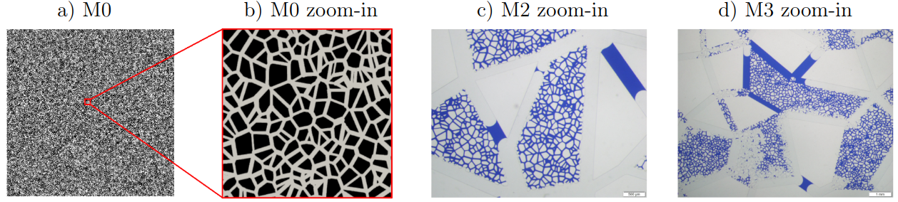
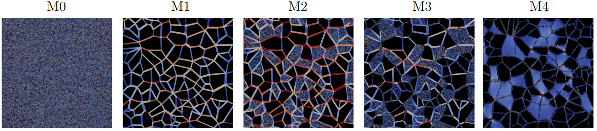

************************
Multiscale Micromodels
************************

In the field of porous media experimentation, recent advances in micromodel fabrication have enabled the development of multiscale rock analogs 
for experimental studies of flow in porous media. These multiscale systems are characterized by the coexistence of two distinct pore-size ranges, 
corresponding to micro- and macroporosity. Owing to their optical accessibility, micromodels allow direct visualization of flow structures and 
provide two-dimensional representations that can effectively reproduce key features of pore geometry and connectivity observed in natural porous media.

In the present benchmark analysis, four micromodels based on Voronoi tessellation (M1, M2, M3 and M4) are simulated and compared with the experimental 
data reported by :cite:t:`wolf2022dual`(https://doi.org/10.1039/D2LC00445C). Each micromodel has a square dimensions of :math:`25 \times 25~mm` 
and approximate depths of :math:`31(0.5)~\mu m`, :math:`34.8(0.9)~\mu m`, :math:`33.6(0.5)~\mu m`, and :math:`32.0(2.9)~\mu m` for models M1, M2, M3, and M4, 
respectively. :numref:`Figure %s <MX-Pore-Struc>` illustrates the micromodels structure. 

An additional micromodel M0 is used to represent the microporosity regions incorporated into M2, M3, and M4. These regions are constructed by combining the 
macroporosity structure of M1 with the microporosity structure of M0 at selected locations. :numref:`Figure %s <MX-P-Micro>` illustrates the microporosity present 
in the micromodels using zoomed-in images of the experimental samples. Consequently, each micromodel is characterized by a distinct pore structure, as 
summarized below:

* **Micromodel 0 (M0):** micro-pore scale with pore diameters ranging from approximately :math:`20` to :math:`50~\mu\mathrm{m}`.

* **Micromodel 1 (M1):** macro-pore scale with pore diameters ranging from approximately :math:`200` to :math:`500~\mu\mathrm{m}`.

* **Micromodel 2 (M2):** dual-pore-scale version of M1 in which selected solid grains are replaced by porous grains containing the microporosity of M0 in the region.

* **Micromodel 3 (M3):** dual-pore-scale version of M1 with solid grains and porous throats, both replaced by the microporosity of the M0 sample in specific regions;

* **Micromodel 4 (M4):** dual-pore-scale version of M1 in which selected solid grains are replaced by void regions, while selected throats are replaced by the microporous structure of M0.

.. figure:: ../../../_static/images/MX-Pore-Struc.png
   :width: 80%
   :align: center
   :name: MX-Pore-Struc

   Micromodels based on the Voronoi tessellation: M0 - micro pore scale; M1 - macro pore scale; M2 - dual pore scale version of M1 with porous grains;
   M3 - dual pore scale version of M1 with porous grains and porous throats; M4 - dual pore scale version of M1 with voids and porous throats.

   Micro-porosity based on the Voronoi tessellation: a) M0 micromodel; b) zoomed-in image showing the micro-porosity of the M0 structure; 
   c) zoomed-in image of the micro-porosity in the experimental micromodel M2; d) zoomed-in image of the micro-porosity in the experimental 
   micromodel M3. The experimental micromodel images c) and d) are saturated with two fluids.

A tutorial to generate 3D micromodels is detailed in :doc:`../../../examples/SinglePhasePoreScale/Multiscale-Micromodel/generate-multiscale-micromodels`

-------------------------------------------
Absolute Permeability - Numerical Setup
-------------------------------------------

To simulate the micromodels depicted in :numref:`Figures %s <MX-Pore-Struc>`, the geometries are generated and discretized using the two grid resolutions 
described in :numref:`Tab. %s <grid-micromodels>`. The first and last grid points along the :math:`y`- and :math:`z`-axes are defined as solid nodes, 
representing the micromodel walls. The fluid flow is imposed along the :math:`z`-axis by applying a pressure gradient through an external body force.

.. list-table:: Mesh specifications for the micromodels. The voxel size, grid dimensions, and digital porosity (:math:`\phi_{\mathrm{dig}}`) 
   are expressed in micrometers, number of voxels, and percentage, respectively. Mesh 2 has twice the grid resolution of Mesh 1.
   :header-rows: 1
   :align: center
   :name: grid-micromodels
   :widths: 10 35 35 20

   * 
      * **Model**
      * **Mesh 1** (Voxel size [:math:`\mu\mathrm{m}`] — Grid [:math:`x,y,z`])
      * **Mesh 2** (Voxel size [:math:`\mu\mathrm{m}`] — Grid [:math:`x,y,z`])
      * :math:`\boldsymbol{\phi_{\mathrm{dig}}}` **[%]**
   * 
      * M0
      * :math:`5.00 \;-\; 5000 \times 5002 \times 9`
      * :math:`2.50 \;-\; 10000 \times 10002 \times 16`
      * 46.1
   * 
      * M1
      * :math:`4.42 \;-\; 5646 \times 5648 \times 9`
      * :math:`2.21 \;-\; 11292 \times 11294 \times 16`
      * 27.3
   * 
      * M2
      * :math:`5.00 \;-\; 5000 \times 5002 \times 9`
      * :math:`2.50 \;-\; 10000 \times 10002 \times 16`
      * 40.2
   * 
      * M3
      * :math:`4.86 \;-\; 5148 \times 5150 \times 9`
      * :math:`2.43 \;-\; 10296 \times 10298 \times 16`
      * 33.6
   * 
      * M4
      * :math:`4.57 \;-\; 5468 \times 5470 \times 9`
      * :math:`2.28 \;-\; 10936 \times 10938 \times 16`
      * 36.7

A configuration example for the micromodel simulations is provided in the ``.db`` file below, using the M1 model with a grid size of 
:math:`5646 \times 5648 \times 9` as an example. The domain settings ``InletLayers = 0, 0, 5`` and ``OutletLayers = 0, 0, 5`` are used 
to connect the inlet and outlet regions of the periodic domain.

.. code-block:: c

   MRT {
      tau = 1.0
      F = 0.0, 0.0, 1.0e-6
      timestepMax = 60000
      tolerance = 0.00001
   }
   Domain {
      Filename = "M1-Micro-5646x5648x9.raw"
      ReadType = "8bit"      // data type
      N = 9, 5648, 5646     // size of original image
      nproc = 1, 2, 2        // process grid
      n = 9, 2824, 2823      // sub-domain size
      offset = 0, 0, 0 // offset to read sub-domain
      voxel_length = 4.42    // voxel length (in microns)
      ReadValues = 0, 1, 2   // labels within the original image
      WriteValues = 0, 1, 2  // associated labels to be used by LBPM
      InletLayers = 0, 0, 5 // specify 10 layers along the z-inlet
      OutletLayers = 0, 0, 5 // specify 10 layers along the z-inlet
      BC = 0                 // boundary condition type (0 for periodic)
   }
   Visualization {
      write_silo = true     // write SILO databases with assigned variables
      save_pressure = true    // save pressure field within SILO database
      save_velocity = true    // save velocity field within SILO database
   }

:numref:`Figure %s <MX-Pore_Res>` illustrates the velocity magnitude field obtained for each micromodel. 
:numref:`Tabela %s <Microodels-Perm-0>` analyzes and compares the obtained permeability values for each 
grid and with the experimental results of :cite:t:`wolf2022dual`. The numerically obtained permeability 
values for the micromodels M1, M2, and M3 show good agreement with the experimental values reported by 
:cite:t:`wolf2022dual`. In these cases, the grid convergence test exhibits a trend towards approximating
the experimental values. However, for the M4 model, there is a divergence from the experimental values as
the grid size increases.

   Velocity magnitude field obtained for each micromodel.

.. list-table:: Numerical and experimental comparisons of micromodel permeability. The numerical results obtained using the two meshes are compared with the experimental data reported by :cite:t:`wolf2022dual`. Permeability values are given in darcies (Da), and the discrepancies are expressed as percentages.
   :name: Microodels-Perm-0
   :header-rows: 2
   :align: center
   :widths: 10 15 15 20 20 20

   * 
      * **Model**
      * **Mesh 1**
      * **Mesh 2**
      * **Mesh discrepancy**
      * **Experimental** :cite:t:`wolf2022dual`
      * **Experimental discrepancy**
   * 
      *
      * :math:`k_1` [Da]
      * :math:`k_2` [Da]
      * :math:`\left|\frac{k_1-k_2}{k_2}\right| \times 100` [%]
      * :math:`k_{\mathrm{exp}}` [Da]
      * :math:`\left|\frac{k_2-k_{\mathrm{exp}}}{k_{\mathrm{exp}}}\right| \times 100` [%]
   * 
      * M0
      * 10.92
      * 10.06
      * 8.95
      * —
      * —
   * 
      * M1
      * 9.49
      * 8.88
      * 6.87
      * 8.91 (0.03)
      * 0.33
   * 
      * M2
      * 16.56
      * 15.42
      * 7.39
      * 13.24 (0.44)
      * 16.46
   * 
      * M3
      * 7.26
      * 6.52
      * 11.35
      * 5.74 (0.01)
      * 13.58
   * 
      * M4
      * 4.41
      * 3.75
      * 17.60
      * 5.71 (1.25)
      * 34.32