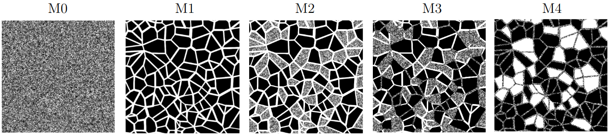

==================================================================
Image Preprocessing Tutorial for Multiscale Micromodel Simulations
==================================================================

This guide provides instructions on how to download, preprocess, and configure the Voronoi geometry images used in :doc:`../../../examples/SinglePhasePoreScale/Multiscale-Micromodel/Multiscale-Micromodel`.

***********************************
Environment Setup and Data Download
***********************************

First, it is highly recommended to create a dedicated working directory to organize all files related to the
Voronoi geometry simulations.

Download the original 80 x 80 mm images in Well-Known Text (``.wkt``) format from the
following link: `Download WKT Images <https://u.pcloud.link/publink/show?code=AIGitalK>`_

You can download the five ``.wkt`` files individually or download the entire set using the provided ``.zip`` file.

**************************************
Installing the ``polyToVTK`` Converter
**************************************

Once the images are downloaded, you must convert them from ``.wkt`` to ``.raw`` format. The ``polyToVTK`` tool is a
C++ converter specifically designed to handle the requirements of these Voronoi simulations.

The source code relies exclusively on native C++ resources and libraries (C++17 standard is required).

Clone the repository and compile the tool using the following commands:

.. code-block:: bash

   git clone -b 3d-extrusion --single-branch https://github.com/poro-labcc/polyToVTK.git
   cd polyToVTK
   make

***********************
Image Conversion Script
***********************

To automate the conversion process across all models (M0 to M4) and meshes, save the following bash script
as ``convert_meshes.sh`` in the directory containing your ``.wkt`` images.

.. code-block:: bash

    #!/bin/bash

    # Exit immediately if a command exits with a non-zero status
    set -e

    # ==============================================================
    # Global Variables
    # ==============================================================
    CURRENT_DIR=$(pwd)

    # Update this path if polyToVTK is installed elsewhere
    POLYTOVTK="${CURRENT_DIR}/polyToVTK/polytovtk"
    WKT_DIR="${CURRENT_DIR}/wkt_files"
    OUT_DIR="${CURRENT_DIR}/simulation_files"

    # ==============================================================
    # Common Parameters
    # ==============================================================
    VAR_COMMON="-r 27500 52500 27500 52500 -t yzx -l 0 1 -p 0 0 1 1 1 1"

    BUF_MESH1="-b 6 6 0 0 0 0"
    BUF_MESH2="-b 12 12 0 0 0 0"

    VAR_3D_MESH1="${BUF_MESH1} ${VAR_COMMON}"
    VAR_3D_MESH2="${BUF_MESH2} ${VAR_COMMON}"

    # ==============================================================
    # Directory Organization
    # ==============================================================
    mkdir -p "${WKT_DIR}" "${CURRENT_DIR}/svg_files" "${OUT_DIR}"

    mv ./*.wkt "${WKT_DIR}/" 2>/dev/null || true
    mv ./*.svg "${CURRENT_DIR}/svg_files/" 2>/dev/null || true

    for m in m0 m1 m2 m3 m4; do
        for mesh in mesh1 mesh2; do
            mkdir -p "${OUT_DIR}/${m}/${mesh}"
        done
    done

    # ==============================================================
    # WKT to RAW Conversions
    # ==============================================================

    # M0 - Micro pore scale
    $POLYTOVTK -i "${WKT_DIR}/mm_alpha_006_micro_mono.wkt" --raw "${OUT_DIR}/m0/mesh1/m0_mesh1_r5.raw" -s 5000 5000 7 $VAR_3D_MESH1
    $POLYTOVTK -i "${WKT_DIR}/mm_alpha_006_micro_mono.wkt" --raw "${OUT_DIR}/m0/mesh2/m0_mesh2_r2p5.raw" -s 10000 10000 14 $VAR_3D_MESH2

    # M1 - Macro pore scale
    $POLYTOVTK -i "${WKT_DIR}/mm_alpha_006_macro_mono.wkt" --raw "${OUT_DIR}/m1/mesh1/m1_mesh1_r4p42.raw" -s 5646 5646 7 $VAR_3D_MESH1
    $POLYTOVTK -i "${WKT_DIR}/mm_alpha_006_macro_mono.wkt" --raw "${OUT_DIR}/m1/mesh2/m1_mesh2_r2p21.raw" -s 11292 11292 14 $VAR_3D_MESH2

    # M2 - Porous grains
    $POLYTOVTK -i "${WKT_DIR}/mm_alpha_006_withPorousGrains.wkt" --raw "${OUT_DIR}/m2/mesh1/m2_mesh1_r5.raw" -s 5000 5000 7 $VAR_3D_MESH1
    $POLYTOVTK -i "${WKT_DIR}/mm_alpha_006_withPorousGrains.wkt" --raw "${OUT_DIR}/m2/mesh2/m2_mesh2_r2p5.raw" -s 10000 10000 14 $VAR_3D_MESH2

    # M3 - Porous grains and throats
    $POLYTOVTK -i "${WKT_DIR}/mm_alpha_006_withPorousGrainsWithPorousThroats.wkt" --raw "${OUT_DIR}/m3/mesh1/m3_mesh1_r4p86.raw" -s 5148 5148 7 $VAR_3D_MESH1
    $POLYTOVTK -i "${WKT_DIR}/mm_alpha_006_withPorousGrainsWithPorousThroats.wkt" --raw "${OUT_DIR}/m3/mesh2/m3_mesh2_r2p43.raw" -s 10296 10296 14 $VAR_3D_MESH2

    # M4 - Voids and porous throats
    $POLYTOVTK -i "${WKT_DIR}/mm_alpha_006_withVoidsWithPorousThroats.wkt" --raw "${OUT_DIR}/m4/mesh1/m4_mesh1_r4p57.raw" -s 5468 5468 7 $VAR_3D_MESH1
    $POLYTOVTK -i "${WKT_DIR}/mm_alpha_006_withVoidsWithPorousThroats.wkt" --raw "${OUT_DIR}/m4/mesh2/m4_mesh2_r2p28.raw" -s 10936 10936 14 $VAR_3D_MESH2

   Micromodels based on the Voronoi tessellation: M0 - micro pore scale; M1 - macro pore scale; M2 - dual pore scale version of M1 with porous grains;
   M3 - dual pore scale version of M1 with porous grains and porous throats; M4 - dual pore scale version of M1 with voids and porous throats.

If you installed ``polyToVTK`` in a different directory, update the ``POLYTOVTK`` path variable in the script accordingly.

Make the script executable:

.. code-block:: bash

   chmod +x convert_meshes.sh

And run it:

.. code-block:: bash

   ./convert_meshes.sh

The script generates both a ``.raw`` and an ``.mhd`` file for each
processed image.

Parameter Breakdown
-------------------

The parameters utilized in the script perform the following physical boundary adjustments:

* ``-r 27500 52500 27500 52500``: Crops a 25 x 25 mm section from the center of the image.
* ``-t yzx``: Transposes the axes to align the flow axis with the LBPM Z-axis.
* ``-l 0 1``: Relabels the solid phase as ``0`` and the pore phase as ``1``.
* ``-p 0 0 1 1 1 1``: Applies solid padding to replicate the micromodel confinement conditions.
* ``-b 12 12 0 0 0 0``: Applies a pore buffer to ensure connectivity for periodic simulations.
* ``-s 10296 10296 14``: Defines the spatial XYZ dimensions of the domain (calculated prior to transposition, padding, and buffering).

*****************************
LBPM Simulation Configuration
*****************************

Below follow an example of ``.db`` file to run a absolute permearability simulation using the newly generated ``.raw`` files. For 
more details see :doc:`../../../examples/SinglePhasePoreScale/Multiscale-Micromodel/Multiscale-Micromodel`.

.. code-block:: text

   Domain {
       Filename = "m1_mesh1_r4p42.raw"    // Change for each simulation
       ReadType = "8bit"
       offset = 0, 0, 0
       voxel_length = 4.42791             // Change for each simulation
       N = 5648, 9, 5658                  // Change for each simulation
       nproc = 2, 1, 2                    // Change for each simulation
       n = 2824, 9, 2829                  // Change for each simulation
       ReadValues = 0, 1
       WriteValues = 0, 1
       InletLayers = 0, 0, 0
       OutletLayers = 0, 0, 0
       BC = 0
   }
   Visualization {
       format = "vtk"
       write_silo = true
       save_8bit_raw = false
       save_phase_field = true
       save_pressure = true
       save_velocity = true
   }
   MRT {
       tau = 0.9330127
       F = 0.0, 0.0, 1e-06
       timestepMax = 1000000
       tolerance = 1e-06
   }

Make sure to update the ``Filename``, ``voxel_length``, ``N``, ``nproc``, and ``n`` fields according to the specific mesh and 
hardware distribution youare simulating.
