.. _rev-benchmarks:

########################################
REV Benchmarks for Digital Porous Media
########################################

These benchmarks evaluate porosity, specific surface area, absolute
permeability, and hydraulic tortuosity for **Berea sandstone**, **LV60A
sandpack**, and **C2 carbonate** using ``lbpm_rev_analysis``. Each sample is
analyzed with four configurations to compare the effects of convergence
tolerance, statistical sample count, and subvolume growth rate.

The methodology, convergence criteria, and output columns are described in
the :doc:`REV user guide <../../../userGuide/models/rev/rev>`. All three
samples come from the Imperial College Consortium on Pore-scale Imaging
and Modelling collection. 

****************************
Samples and numerical setup
****************************

.. list-table::
   :widths: 50 50 50
   :align: center

   * - .. figure:: ../../../_static/images/3d-berea.png
          :width: 60%
          :align: center
          :alt: Segmented three-dimensional Berea sandstone sample.
          :name: rev-sample-berea

          Berea sandstone :cite:p:`dong2008berea`.

     - .. figure:: ../../../_static/images/3d-lv60a.png
          :width: 60%
          :align: center
          :alt: Segmented three-dimensional LV60A sandpack sample.
          :name: rev-sample-lv60a

          LV60A sandpack :cite:p:`dong2008lv60a`.

     - .. figure:: ../../../_static/images/3d-c2.png
          :width: 60%
          :align: center
          :alt: Segmented three-dimensional C2 carbonate sample.
          :name: rev-sample-c2

          C2 carbonate :cite:p:`dong2008c2`.

.. list-table:: Digital samples and saved flow fields used for REV analysis.
   :header-rows: 1
   :widths: 25 25 20 30
   :align: center
   :name: rev-benchmark-samples

   * - Sample
     - Image size (voxels)
     - Voxel length (:math:`\mu\mathrm{m}`)
     - Saved velocity timestep
   * - Berea sandstone
     - :math:`400 \times 400 \times 400`
     - 5.345
     - ``vis13000``
   * - LV60A sandpack
     - :math:`450 \times 450 \times 450`
     - 10.002
     - ``vis3000``
   * - C2 carbonate
     - :math:`400 \times 400 \times 400`
     - 5.345
     - ``vis123000``

All samples use the same flow-simulation setup, with sample-specific image
dimensions and voxel lengths. The Berea input is provided below.

.. raw:: html

   

   
<strong>Click here to open: Flow-simulation .db example: Berea</strong>

.. code-block:: text

   MRT {
      tau = 1.0
      F = 0.0, 0.0, 1.0e-6
      timestepMax = 150000
      tolerance = 0.001
   }
   Domain {
      Filename = "Berea.raw"
      ReadType = "8bit"
      ReadValues = 0, 1
      WriteValues = 1, 0
      N = 400, 400, 400
      n = 400, 400, 400
      nproc = 1, 1, 1
      voxel_length = 5.345
      InletLayers = 0, 0, 5
      OutletLayers = 0, 0, 5
      BC = 0
   }
   Visualization {
      write_silo = true
      save_pressure = true
      save_velocity = true
   }

.. raw:: html

   

.. raw:: html

    

.. list-table:: Full-domain reference values.
   :header-rows: 1
   :widths: 24 18 22 20 16
   :align: center
   :name: rev-benchmark-reference-values

   * - Sample
     - :math:`\phi` (-)
     - :math:`S_v` (:math:`\mu\mathrm{m}^{-1}`)
     - :math:`K_z` (mD)
     - :math:`\tau_h` (-)
   * - Berea
     - 0.200361
     - 0.0242666
     - 1686.12
     - 1.68381
   * - LV60A
     - 0.368987
     - 0.0225087
     - 35877.7
     - 1.32582
   * - C2
     - 0.173010
     - 0.0202131
     - 150.906
     - 2.36855

Hydraulic properties are evaluated from the saved full-domain velocity
fields.

****************************
REV configurations
****************************

.. list-table:: Parameters varied in the four benchmark configurations.
   :header-rows: 1
   :widths: 25 25 25 25
   :align: center
   :name: rev-benchmark-configurations

   * - Configuration
     - ``gamma``
     - ``StatSamples``
     - ``SizeStep``
   * - A: baseline
     - 0.10
     - 50
     - 0.06
   * - B: baseline with 100 samples
     - 0.10
     - 100
     - 0.06
   * - C: 7% tolerance, 100 samples
     - 0.07
     - 100
     - 0.06
   * - D: 7% tolerance, 10% growth
     - 0.07
     - 100
     - 0.10

All cases use ``CCInterval = 10``, ``Seed_Anchor = True``, and both
geometrical and hydraulic analysis.
A–B compares sample counts, B–C compares tolerances, and C–D compares
growth rates.

REV sizes are defined by the statistical analysis and reported as edge
lengths in voxels in the tables below. Figure values are
normalized by the full-domain references above. Solid curves end where
statistical sampling begins; symbols and error bars show statistical means
and standard deviations. Colored dashed lines mark statistical REVs, and the black
vertical line marks the maximum-size reference (70% of the image edge).

****************************
Berea sandstone
****************************

.. list-table:: Berea statistical REV edge lengths in voxels.
   :header-rows: 1
   :widths: 20 20 20 20 20
   :align: center
   :name: rev-benchmark-berea

   * - Configuration
     - :math:`\ell_{\phi}`
     - :math:`\ell_{S_v}`
     - :math:`\ell_{K_z}`
     - :math:`\ell_{\tau_h}`
   * - A
     - 114
     - 91
     - 206
     - 154
   * - B
     - 107
     - 91
     - 206
     - 173
   * - C
     - 145
     - 91
     - 231
     - 218
   * - D
     - 149
     - 92
     - 239
     - 217

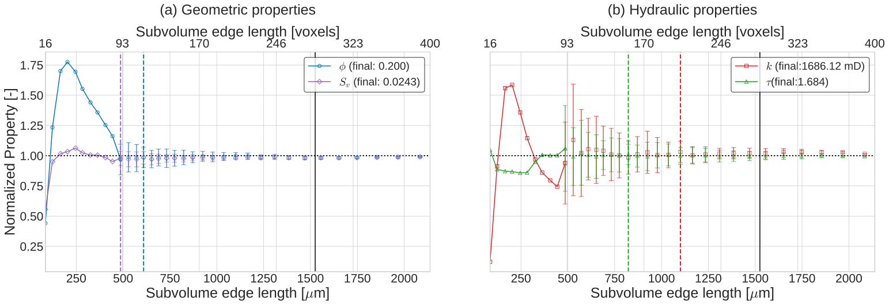

   Berea sandstone: configuration A (10% tolerance, 50 samples, 6% growth).

.. raw:: html

   

   
<strong>Click here to open: Berea configurations B, C, and D</strong>

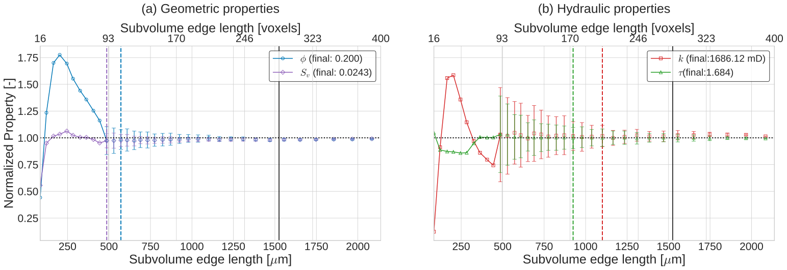

   Berea sandstone: configuration B (10% tolerance, 100 samples, 6% growth).

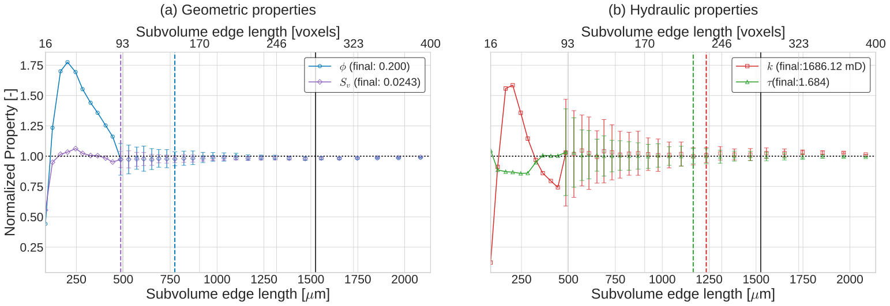

   Berea sandstone: configuration C (7% tolerance, 100 samples, 6% growth).

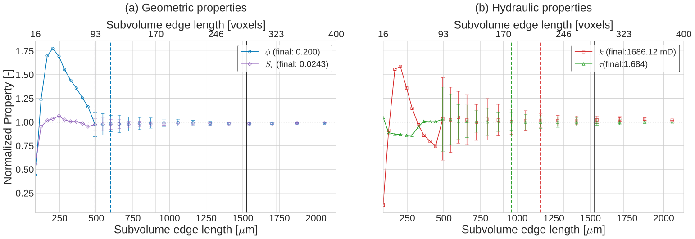

   Berea sandstone: configuration D (7% tolerance, 100 samples, 10% growth).

.. raw:: html

   

.. raw:: html

    

****************************
LV60A sandpack
****************************

.. list-table:: LV60A statistical REV edge lengths in voxels.
   :header-rows: 1
   :widths: 20 20 20 20 20
   :align: center
   :name: rev-benchmark-lv60a

   * - Configuration
     - :math:`\ell_{\phi}`
     - :math:`\ell_{S_v}`
     - :math:`\ell_{K_z}`
     - :math:`\ell_{\tau_h}`
   * - A
     - 56
     - 42
     - 133
     - 84
   * - B
     - 49
     - 49
     - 141
     - 84
   * - C
     - 83
     - 83
     - 199
     - 111
   * - D
     - 84
     - 84
     - 199
     - 102

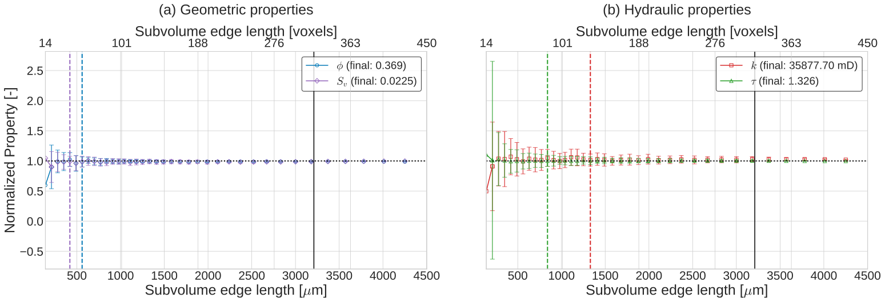

   LV60A sandpack: configuration A (10% tolerance, 50 samples, 6% growth).

.. raw:: html

   

   
<strong>Click here to open: LV60A configurations B, C, and D</strong>

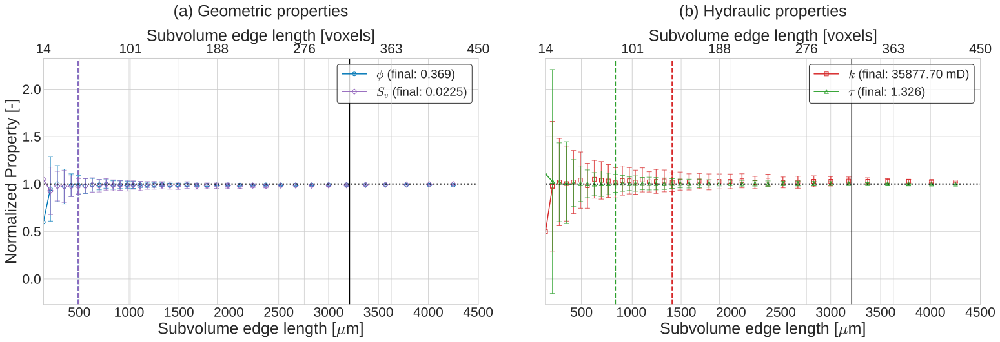

   LV60A sandpack: configuration B (10% tolerance, 100 samples, 6% growth).

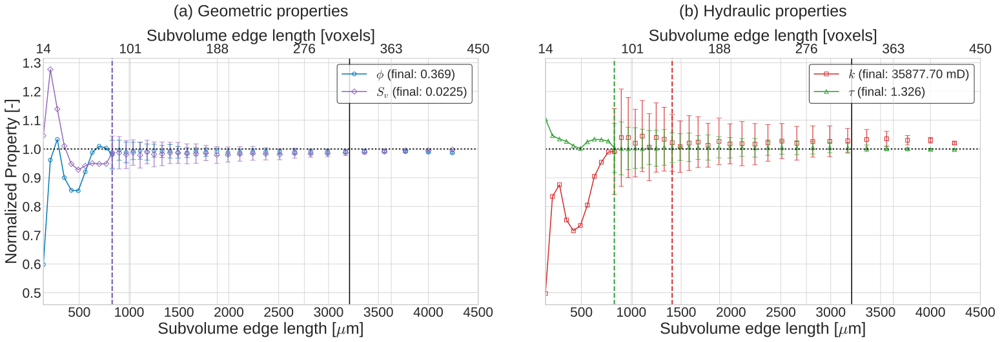

   LV60A sandpack: configuration C (7% tolerance, 100 samples, 6% growth).

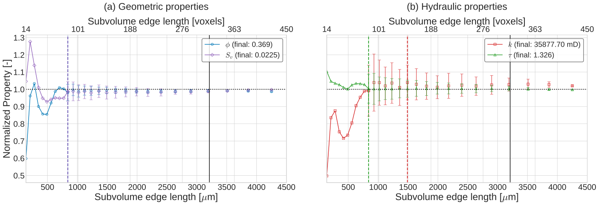

   LV60A sandpack: configuration D (7% tolerance, 100 samples, 10% growth).

.. raw:: html

   

.. raw:: html

    

****************************
C2 carbonate
****************************

.. list-table:: C2 statistical REV edge lengths in voxels.
   :header-rows: 1
   :widths: 20 20 20 20 20
   :align: center
   :name: rev-benchmark-c2

   * - Configuration
     - :math:`\ell_{\phi}`
     - :math:`\ell_{S_v}`
     - :math:`\ell_{K_z}`
     - :math:`\ell_{\tau_h}`
   * - A
     - 319
     - 301
     - 338
     - 301
   * - B
     - 319
     - 284
     - 359
     - 301
   * - C
     - 338
     - 319
     - 359
     - 319
   * - D
     - 323
     - 323
     - 355
     - 323

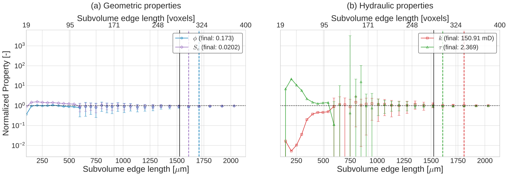

   C2 carbonate: configuration A (10% tolerance, 50 samples, 6% growth).

.. raw:: html

   

   
<strong>Click here to open: C2 configurations B, C, and D</strong>

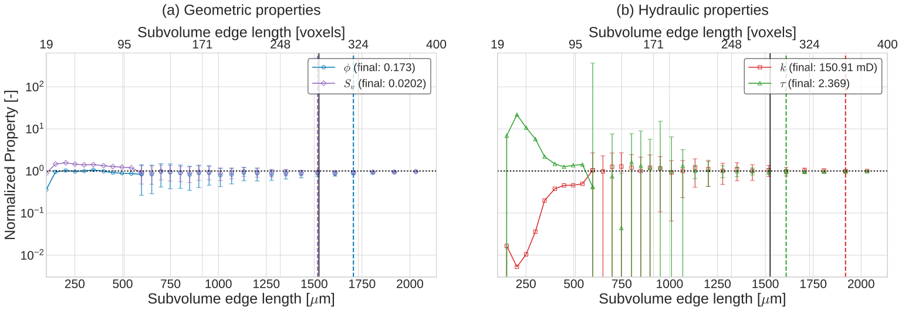

   C2 carbonate: configuration B (10% tolerance, 100 samples, 6% growth).

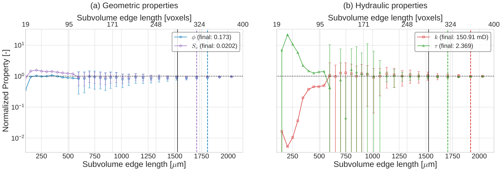

   C2 carbonate: configuration C (7% tolerance, 100 samples, 6% growth).

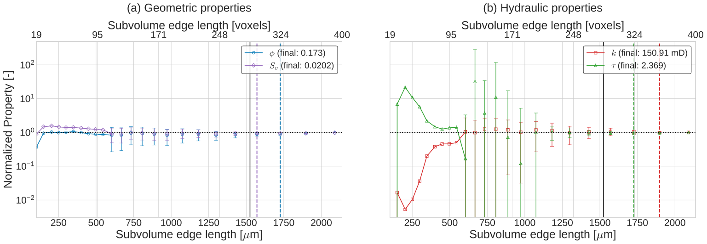

   C2 carbonate: configuration D (7% tolerance, 100 samples, 10% growth).

.. raw:: html

   

.. raw:: html

    

****************************
Discussion
****************************

Permeability requires the largest statistical REV in every sample and
configuration. Relative to each image edge, its range across A–D is
29.6–44.2% for LV60A, 51.5–59.8% for Berea, and 84.5–89.8% for C2.
The separation between geometric and permeability scales is greater in
Berea and LV60A; C2 requires large windows for both property groups.

Statistical sample count: A–B
-----------------------------

Doubling the sample count from 50 to 100 affects the properties differently.
The permeability REV remains at 206 voxels for Berea and increases for LV60A and 
for C2. Porosity REVs decrease in Berea and LV60A and remain unchanged in C2.
Surface-area REVs remain unchanged in Berea, increase in LV60A, and decrease in C2;
tortuosity changes only in Berea.

The shifts in REV edge lengths reflect sensitivity to the sampled subvolumes.
Adding statistical subvolumes to the analysis increases the evaluated information, providing more spatial samples for estimating dispersion. However, this addition increases
computational cost.  

Convergence tolerance: B–C
----------------------------

Reducing the tolerance from 10% to 7%, while retaining 100 samples per
size, yields equal or larger statistical REV sizes for all samples
and properties.

Berea and C2 have identical statistical measurements in configurations B and C.
Their changes in REV size therefore result directly from applying a
stricter threshold to the same measurements. A fixed seed ensures
reproducible sampling for a given configuration, but does not guarantee
identical measurements when the sampled size sequence changes.

For LV60A, the stricter deterministic convergence criteria shift the
initial statistical size from 21 voxels in B to 83 voxels in C.
Consequently, this comparison reflects both the stricter statistical
threshold and a change in the sampled size sequence. Both geometric
properties already satisfy the statistical criterion at the first
evaluated size in C; their reported REV sizes therefore do not resolve
whether convergence would also occur at smaller windows.

Subvolume growth rate: C–D
--------------------------

Increasing the growth rate from 6% to 10% reduces the number of statistical
sizes evaluated from 25 to 16 for Berea, 28 to 18 for LV60A, and 21 to 14
for C2, with 100 samples per size retained. Permeability REVs change slightly
because the evaluated sizes are not exactly the same.

D therefore uses fewer sampled windows while giving similar permeability
REV estimates in these tests. Changes in the evaluated sizes and window
locations can move estimates in either direction, as illustrated by the
smaller C2 porosity REV and LV60A tortuosity REV in D. Fewer subvolumes are
evaluated at the cost of coarser sampling of subvolume edge lengths.

C2 sample remarks
-----------------

The C2 results are plotted on logarithmic axes to accommodate the wide
range of positive normalized values. Negative estimates are not
represented on these axes.

Hydraulic tortuosity exhibits particularly large fluctuations in small
subvolumes. Local recirculation can produce negative net axial flow,
yielding negative tortuosity estimates. Cancellation between positive
and negative estimates can bring the mean tortuosity close to one.
Since its coefficient of variation is calculated from
:math:`\tau_h - 1`, this makes the normalization denominator approach
zero and can produce very large CV values. Undefined estimates, stored
internally as ``-1``, are excluded from these statistics.

Across configurations A–D, all properties meet the statistical REV
criterion at edge lengths spanning approximately 71–90% of the image
edge. Permeability requires the largest windows, at 338–359 voxels
(84.5–89.8%). At these sizes, substantial overlap between sampled
subvolumes can contribute to the reduction in dispersion. These results
therefore demonstrate convergence within the available image, while
representativeness at larger scales remains unverified.
