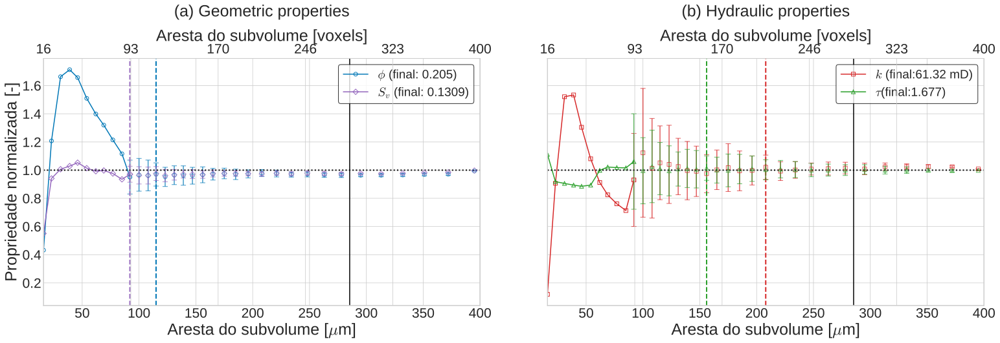

###############################################################################
Representative Elementary Volume (REV) Analysis (lbpm_rev_analysis)
###############################################################################

The degree of heterogeneity observed in digital rocks is an important factor in characterizing porous media. Advances
in the resolution and sample size achievable with X-ray microtomography have made it increasingly feasible to digitally
investigate larger volumes that capture the intrinsic heterogeneities of porous structures. These developments enable the
identification of representative elementary volumes (REVs), beyond which the influence of local heterogeneities becomes
negligible and specific effective properties of the porous medium can be reliably characterized.

The ``lbpm_rev_analysis`` routine provides an automated REV analysis for a range of
geometrical and hydrodynamic properties, as summarized in :numref:`Table %s <rev-properties>`. By combining deterministic and statistical approaches,
the routine enables a comprehensive characterization of these properties, providing valuable insights for assessing the
representativeness of microtomography images and estimating effective sample volumes for subsequent numerical analyses.

.. _rev-properties:

.. list-table:: Properties available for REV analysis.
   :widths: 25 25 25
   :header-rows: 1
   :align: center

   * -
     - Property 1
     - Property 2
   * - Geometrical
     - Porosity (:math:`\phi`)
     - Superficial Area (:math:`A_{s}`)
   * - Hydrodynamic
     - Absolute Permeability (:math:`K_{z}`)
     - Hydraulic Tortuosity (:math:`\tau_{h}`)

****************************
Methodology
****************************

The implemented REV routine combines deterministic and statistical approaches into a **hybrid methodology**, as illustrated
in the workflow diagram presented in :numref:`rev-workflow`. The deterministic stage provides an initial estimate of the REV
size at a relatively low computational cost. This estimate is subsequently used to initialize the statistical stage, which
evaluates the spatial variability of the property over randomly distributed subvolumes. The deterministic
analysis uses a default convergence threshold of :math:`\gamma = 0.1`. The statistical stage reports
coefficients of variation and retains the first porosity and permeability sizes below this tolerance.
For a detailed explanation of the steps illustrated in :numref:`rev-workflow`,
expand the toggle sections below for the deterministic and statistical analyses.

.. list-table::
   :widths: 50 50
   :class: borderless
   :align: center

   * - .. figure:: ../../../_static/images/rev-workflow.svg
          :width: 70%
          :align: center
          :name: rev-workflow

          Workflow of the hybrid REV analysis, combining deterministic
          (steps 1–5) and statistical (steps 6–9) convergence assessments.

     - .. figure:: ../../../_static/images/REVHybridAnimation.gif
          :width: 100%
          :align: center
          :name: rev-GIF

          GIF Animation illustrating the hybrid REV analysis for porosity.

----------------------
Deterministic Analysis
----------------------

.. raw:: html

   

   
<strong>Click here to open: Deterministic Analysis</strong>

The **deterministic approach** evaluates a property of interest within a
subvolume centered in the computational domain. The analysis is repeated
for progressively larger subvolumes until the measured property becomes
approximately independent of the subvolume edge length. The smallest
subvolume satisfying the prescribed convergence criteria is identified
as the deterministic REV.

The main advantage of this approach is its relatively low computational
cost, as only one subvolume is evaluated for each edge length. However,
the results may be sensitive to local fluctuations, including maxima,
minima, and inflection points, potentially leading to false convergence.

The deterministic procedure, illustrated in the upper part of the
workflow diagram, consists of the following steps:

#. **Initialize the subvolume size:** The initial edge length is defined
   as twice the average pore diameter,

   .. math::

      \ell_0 = 2\overline{d}_p.

#. **Evaluate the domain-size constraint:** Before each evaluation,
   the subvolume dimensions are checked against the available computational
   domain. If the prescribed maximum size is exceeded before convergence,
   no deterministic REV is identified.

#. **Measure the property:** The property of interest, :math:`\eta_i`,
   is evaluated within the centered subvolume.

#. **Compute the convergence criteria:** Two complementary metrics are
   calculated to quantify the variation of the measured property with
   increasing subvolume size.

   The first metric is the relative error (RE), defined as

   .. math::
      :label: rev-relative-error

      RE_i =
      \left|
      \frac{q_i-q_{i-1}}
      {q_i+q_{i-1}}
      \frac{V_{i-1}}{V_i}
      \right| < \gamma,

   where :math:`RE_i` is the relative error at iteration :math:`i`,
   :math:`q_i` represents the measured property in the :math:`i`-th
   subvolume, and :math:`V_i` denotes the volume of that sampled subvolume.
   This metric quantifies the local variation of the property as the
   evaluated subvolume increases in size.

   The second metric is the convergence criterion (CC), introduced by
   :cite:t:`Marafini2020`:

   .. math::
      :label: rev-convergence-criterion

      CC_i =
      \frac{
      \sigma(\eta_{i-m+1},\ldots,\eta_i)
      }{
      \overline{\eta}(\eta_{i-m+1},\ldots,\eta_i)
      } < \gamma,

   where :math:`\sigma` denotes the standard deviation,
   :math:`\overline{\eta}` represents the arithmetic mean, and
   :math:`m` is the number of consecutive measurements considered.
   By evaluating the dispersion of the most recent measurements,
   this metric reduces the likelihood of false convergence associated
   with local fluctuations. The default value is :math:`m=10`.

#. **Assess convergence and update the subvolume size:** The first subvolume
   size for which both convergence criteria satisfy the prescribed tolerance
   is recorded as the deterministic REV for each property. Sizes continue to
   increase up to the maximum admissible domain size. The proportional growth
   is controlled by ``SizeStep``; for example, ``SizeStep = 0.06`` gives the
   nominal update

   .. math::
      :label: rev-edge-growth

      \ell_{i+1}=1.06\ell_i,

   The implementation also applies a minimum increment based on the average
   pore diameter and rounds the edge length upward to whole voxels, so the
   actual increase can be larger. The default ``SizeStep`` is ``0.06`` (6%).

.. raw:: html

   

.. raw:: html

    

--------------------
Statistical Analysis
--------------------

.. raw:: html

   

   
<strong>Click here to open: Statistical Analysis</strong>

The **statistical approach** evaluates the spatial variability of a
property by sampling multiple subvolumes distributed throughout the
computational domain. For a given edge length, the property is measured
in a set of randomly selected subvolumes, and the dispersion of the
resulting measurements is assessed.

The current implementation repeats this sampling for increasing subvolume
sizes and reports the dispersion at each size. These results can be compared
with the prescribed tolerance to identify sufficiently consistent measurements.

Compared with the deterministic approach, statistical analysis is
computationally more expensive because multiple subvolumes must be
evaluated at each edge length. Nevertheless, it provides a more robust
assessment of spatial heterogeneity and reduces the risk of identifying
false convergence caused by localized features.

An important limitation arises as the subvolume size approaches the
dimensions of the computational domain. In this situation, increasing
overlap between sampled subvolumes can artificially reduce the measured
dispersion, potentially leading to an overestimation of convergence.

The statistical procedure, represented in the lower part of the workflow
diagram, follows these steps:

6. **Initialize the statistical analysis:** The edge length corresponding
   to the deterministic REV is adopted as the initial subvolume size,
   avoiding the repeated evaluation of smaller volumes that have already
   been assessed.

7. **Select and evaluate random subvolumes:** For the prescribed edge
   length, :math:`N` subvolumes are randomly distributed within the
   computational domain, and the property of interest is evaluated
   independently in each subvolume.

8. **Evaluate statistical convergence:** The dispersion of the measurements
   is quantified using the coefficient of variation (CV), following
   :cite:t:`Zhang2000`:

   .. math::
      :label: rev-coefficient-variation

      CV = \frac{\sigma(\eta)}{\overline{\eta}} < \gamma,

   where :math:`\sigma(\eta)` is the standard deviation of the property
   measurements and :math:`\overline{\eta}` is their arithmetic mean.
   Normalization by the mean provides a dimensionless measure of relative
   dispersion.

   The number of sampled subvolumes is fixed by ``StatSamples`` and defaults
   to 50 at each size. The current routine does not adapt this count based on
   the stability of the estimated CV.

9. **Assess the statistical REV:** The routine retains the first size with
   ``0 <= CV < gamma`` independently for porosity and permeability, together
   with its mean and dimensions. It continues reporting the subsequent sizes
   using ``SizeStep`` and the minimum increment described above until the
   admissible domain-size limit is reached. ``SubdomainSelect`` optionally
   uses these retained results to select representative windows.

.. raw:: html

   

.. raw:: html

    

************************************
Run REV Analysis
************************************

REV analysis can be performed either alongside a single-phase permeability simulation
using ``lbpm_rev_permeability_simulator``, or independently using ``lbpm_rev_analysis``.

Currently, neither routine supports parallel execution across multiple MPI processes.
Therefore, both routines must be executed using a single MPI process. To ensure
compatibility, the ``Domain`` configuration must be set to ``nproc = 1, 1, 1`` in the corresponding
configuration block.

--------------------------------
lbpm_rev_permeability_simulator
--------------------------------

Falar da caso MRT BC=0

The ``lbpm_rev_permeability_simulator`` executable runs the single-phase flow
simulation, computes the velocity field, and then performs deterministic and
statistical REV analyses. A typical command for a single-process run is:

.. code-block:: bash

   mpirun -np 1 lbpm_rev_permeability_simulator input.db

The standard ``lbpm_permeability_simulator`` executable does not invoke the REV
routines. Use the REV-enabled executable above for the combined workflow. REV analysis
is activated by the presence of a ``REV`` block in ``input.db``, alongside the usual
``Domain`` and ``MRT`` blocks. For example:

.. code-block:: text

   REV {
      Geometrical = True
      Hydraulic = True
      gamma = 0.1
      SizeStep = 0.06
      CCInterval = 10
      StatSamples = 50
      Seed_Anchor = True
   }

--------------------------------
lbpm_rev_analysis
--------------------------------

The routine ``lbpm_rev_analysis`` performs REV analysis from an input geometry.
Geometrical analysis requires the geometry alone; hydraulic analysis also
requires velocity fields saved by an earlier single-phase flow simulation.

.. code-block:: bash

   mpirun -np 1 lbpm_rev_analysis input.db

For geometrical analysis alone, the geometry is sufficient. ``Hydraulic``
defaults to ``False`` in this routine, so porosity and specific surface area
can be evaluated without loading velocity fields. This default can also be
set explicitly:

.. code-block:: text

   REV {
      Geometrical = True
      Hydraulic = False
      Seed_Anchor = True
   }

An ``MRT`` block is not required for this configuration. Set ``Hydraulic = True`` explicitly to enable
hydraulic analysis when previously saved flow results are available. However, this analysis requires
velocity fields obtained from a prior single-phase flow simulation. For example, the following configuration
block enables both property groups:

.. code-block:: text

   REV {
      Geometrical = True
      Hydraulic = True
      Seed_Anchor = True
      SimulationParams = "/path/to/simulation/input.db"
      VelocityPath = "/path/to/simulation/results"
      VelocityTimestep = "vis3000"
   }

When ``Hydraulic = True``, all three settings, ``SimulationParams``,
``VelocityPath``, and ``VelocityTimestep``, must be explicitly supplied and
nonempty. If any are missing or blank, ``lbpm_rev_analysis`` prints a message
listing them and exits with a nonzero status before loading the saved files or
geometry. These settings are not required for geometrical analysis alone.

Note that, in addition to the velocity fields saved in the ``vis*`` folder, it is also necessary to provide
the path to the ``input.db`` file used in the previous single-phase flow simulation. This file is required to
retrieve the pressure drop and fluid viscosity used to calculate the absolute permeability.

------------------------------
Model parameters
------------------------------

For a detailed description of the REV analysis parameters, expand the section 
below using the toggle button.

.. raw:: html

   

   
<strong>Click here to open: REV Parameters</strong>

``Geometrical`` and ``Hydraulic`` select the property groups evaluated in both
analysis stages. Setting ``Geometrical = True`` enables porosity and specific
surface area analysis, while ``Hydraulic = True`` enables permeability and
hydraulic tortuosity analysis. Setting either parameter to ``False`` skips its
corresponding group. ``Geometrical`` defaults to ``True`` in both routines.
``Hydraulic`` defaults to ``False`` in ``lbpm_rev_analysis`` and to ``True`` in
``lbpm_rev_permeability_simulator``. An explicit setting overrides the default.
Setting both parameters to ``False`` skips both REV analyses.

``gamma`` is the dimensionless convergence tolerance, with a default value of
``0.1``. A deterministic REV is identified for a property when both its relative
error (RE) and convergence criterion (CC) are valid and smaller than ``gamma``.
The statistical analysis independently retains the first porosity and
permeability sizes with a valid coefficient of variation (CV) below ``gamma``,
together with their respective means and window dimensions.
For example, ``gamma = 0.1`` requires both metrics to be below 10%. A smaller
value imposes a stricter convergence requirement and may lead to a larger REV
estimate or prevent convergence within the available domain.

``SizeStep`` controls the proportional increase in subvolume edge length in
both analysis stages. The example value ``0.06`` specifies a 6% increase in edge 
length between successive subvolume sizes, corresponding to an approximate 19% 
increase in volume. The implementation also enforces a minimum increment equal
to the larger of one voxel and the average pore diameter, and rounds the
resulting edge length upward to an integer number of voxels. Consequently, the
actual increase can exceed 6%, especially for small subvolumes. If omitted,
``SizeStep`` defaults to ``0.06``. It must be positive.

``CCInterval`` is the number of recent subvolume-size measurements used to
calculate CC in the deterministic analysis. With ``CCInterval = 10``, CC
measures the relative dispersion of up to the ten most recent measurements;
the available measurements are used before the window is full. Increasing
this value assesses convergence over a longer history of subvolume sizes.
It must be a positive integer and defaults to ``10``.

``StatSamples`` is the number of randomly positioned subvolumes evaluated at
each size during the statistical analysis. With ``StatSamples = 50``, each
property is sampled in 50 subvolumes to calculate its mean, minimum, maximum,
and coefficient of variation (CV). Increasing this value provides more spatial
samples at a higher computational cost. It must be a positive integer and
defaults to ``50``.

``Seed_Anchor`` controls the random generator used to position subvolumes in
the statistical analysis. It defaults to ``True`` in both routines, which
initializes ``std::mt19937`` with the fixed seed ``0`` and makes sampling
reproducible for the same input and configuration. Set ``Seed_Anchor = False``
to initialize the generator with a seed from ``std::random_device``, allowing
the sampled locations to vary between runs. This parameter does not affect
the deterministic analysis.

``SubdomainSelect`` defaults to ``False``. Set it to ``True`` to select
representative subdomains after the statistical analysis, using its retained
REV sizes and means. See :ref:`rev-subdomain-selection` for the numerical
workflow, input restrictions, and outputs.

``subdomain_size`` optionally sets the selection window dimensions in voxels.
A positive integer, such as ``64``, specifies a cube; three positive integers,
such as ``64, 48, 32``, specify the exact x, y, and z dimensions. The setting
applies to both geometric and hydraulic selection and must fit within
``Domain.n``. If omitted, each property uses its own statistical REV window
dimensions. The statistical reference sizes and target means remain unchanged.

``save_subdomain_raw`` defaults to ``false``. Set it to ``true`` to save the
selected geometric and hydraulic windows as raw crops. The selection CSV and
domain databases are written independently of this setting.

``SimulationParams`` identifies the input database used for the flow simulation.
The referenced database must contain an ``MRT`` block, from which the routine
reads the relaxation time ``tau`` and body-force vector ``F``.
A relative path is resolved against the
directory containing the analysis input database. The
referenced file supplies only these flow parameters; keep the geometry and
``REV`` settings in the analysis database. ``SimulationParams`` is required
when hydraulic analysis is enabled in ``lbpm_rev_analysis``.

``VelocityPath`` is the directory containing the saved LBPM output. Relative
paths are resolved from the current working directory. ``VelocityTimestep``
selects a timestep directory within this path and must be supplied as a quoted
string. Both settings are required when hydraulic analysis is enabled in
``lbpm_rev_analysis``. Use ``VelocityPath = "."`` to select the current working
directory explicitly.

The selected timestep must contain ``LBM.summary`` and a ``domain`` mesh with
the scalar volume fields ``Velocity_x``, ``Velocity_y``, and ``Velocity_z``.
The saved output must contain a single MPI domain whose dimensions match the
analysis geometry. Use the same geometry and voxel length as the original
simulation. For an MRT simulation, enable ``write_silo = True`` in its
``Visualization`` block to save the required velocity fields in LBPM output.

.. raw:: html

   

.. raw:: html

    

The property-selection, convergence, sampling, and subdomain-selection parameters are optional.
The three saved-flow settings are required for standalone hydraulic analysis.
An empty ``REV`` block activates
geometrical analysis in ``lbpm_rev_analysis`` and both property groups in
``lbpm_rev_permeability_simulator``, with ``gamma = 0.1``, ``SizeStep = 0.1``,
``CCInterval = 10``, ``StatSamples = 50``, and ``Seed_Anchor = True``. Omitting
the entire block disables REV analysis.

.. _rev-subdomain-selection:

----------------------------------
Representative subdomain selection
----------------------------------

Enable ``SubdomainSelect`` in ``input.db`` to select representative windows in
either REV executable. For example, select a ``64 x 64 x 64`` geometric
window without hydraulic input, using the statistical REV properties as
selection targets:

.. code-block:: text

   REV {
      Geometrical = True
      Hydraulic = False
      SubdomainSelect = True
      subdomain_size = 64, 32, 16
      save_subdomain_raw = false
      gamma = 0.1
      StatSamples = 50
      Seed_Anchor = True
   }

``save_subdomain_raw`` defaults to ``false`` in both REV executables. Set
``save_subdomain_raw = true`` in the ``REV`` block to export the selected
``.raw`` crops for both geometric and hydraulic selection. With raw export
disabled, selection still writes its CSV and domain databases, leaves existing
raw crops and temporary raw files untouched, and leaves the CSV's ``raw_file``
field blank.

For permeability selection, set ``Hydraulic = True`` and supply the saved-flow
settings described above. Porosity and permeability use their independently
retained statistical REV sizes and means, without repeating REV analysis.
The statistical mean specific surface area is retained at the porosity REV
size, and mean hydraulic tortuosity is retained at the permeability REV size.
Each target pair comes from the same statistical window dimensions. The
independently assessed surface-area and tortuosity REVs do not determine the
selection window sizes.

``subdomain_size`` optionally overrides the selection window dimensions in
voxels. A single positive integer, such as ``subdomain_size = 64``, specifies
a ``64 x 64 x 64`` cube. Alternatively, ``subdomain_size = 64, 48, 32``
specifies the exact x, y, and z dimensions. The configured dimensions apply
to both geometric and hydraulic selection and must fit within the analyzed
``Domain.n``. If omitted, each property uses its own statistical REV window
dimensions: ``L x L x L`` for a cubic image, or the statistical analysis's
proportionally scaled and rounded dimensions for a rectangular image.

The override changes only the selection window. The statistical REV sizes
and all retained target means, including specific surface area and hydraulic
tortuosity, remain unchanged. Candidates at the requested size are compared
against those targets; REV analysis is not repeated at the custom size. A
converged statistical REV and valid target properties are still required.
A custom size does not supply missing reference values or enable selection
for an unconverged property.

The selection scans every valid position, moving one voxel along each axis
and including the last window at each boundary. For the actual geometric
selection window dimensions, it minimizes the following weighted score:

.. math::

   E_{\phi} &= \frac{|\phi_{\mathrm{local}}-\overline{\phi}_{\mathrm{REV}}|}
                    {|\overline{\phi}_{\mathrm{REV}}|}, \\
   E_{S_v} &= \frac{|S_{v,\mathrm{local}}-\overline{S_v}_{\mathrm{REV}}|}
                   {|\overline{S_v}_{\mathrm{REV}}|}, \\
   \mathrm{selection\_score} &= 0.6 E_{\phi} + 0.4 E_{S_v}.

For the actual hydraulic selection window dimensions, hydraulic selection
minimizes:

.. math::

   E_k &= \frac{|k_{\mathrm{local}}-\overline{k}_{\mathrm{REV}}|}
               {|\overline{k}_{\mathrm{REV}}|}, \\
   E_T &= \frac{|T_{\mathrm{local}}-\overline{T}_{\mathrm{REV}}|}
               {|\overline{T}_{\mathrm{REV}}|}, \\
   \mathrm{selection\_score} &= 0.6 E_k + 0.4 E_T.

Lower scores indicate a closer match. The fixed weights are 60% porosity and
40% specific surface area for the geometric region, and 60% permeability and
40% hydraulic tortuosity for the hydraulic region. The weights are fixed.
For every component, a zero mean gives zero deviation
for an exact zero and infinite deviation otherwise. Equal scores select the first candidate, with x changing
fastest, then y and z. An exact match does not stop the scan.

Porosity counts voxels with positive signed distance, following the existing
analysis convention. Specific surface area uses the existing geometric
measure: count internal solid-pore faces once along each of x, y, and z, then
use :math:`S_v = N_{\mathrm{faces}} / (N_{\mathrm{voxels}} h)`, where
:math:`N_{\mathrm{voxels}}` is the number of voxels in the window and
:math:`h` is the voxel length. It has units
of inverse micrometres. Faces on the window exterior and across periodic
boundaries are excluded. Permeability and hydraulic tortuosity are evaluated
together from a fresh numerical MRT flow simulation of each cropped geometry,
with the existing Darcy conversion to millidarcies for permeability.
The retained statistical hydraulic means are calculated from
the earlier full-domain simulation; changing to a cropped geometry with
periodic boundaries can change its flow response.

Hydraulic tortuosity uses the existing displayed analysis convention,
:math:`T = \sum_{\mathrm{pores}} |\mathbf{u}| /
\sum_{\mathrm{pores}} u_z`, evaluated from the converged numerical velocities.
The statistical routine stores ``T - 1`` internally; selection retains ``T``,
matching ``stat_tort_mean``. Its denominator uses z velocity, rather than the
force-projected velocity used for permeability. Flow along positive z gives
the usual positive tortuosity interpretation. A candidate with no flow or
undefined net z transport has undefined tortuosity and cannot win the score;
every window is still evaluated and counted. If no candidate has usable
tortuosity, the hydraulic status is ``no_valid_tortuosity``. An unavailable
statistical tortuosity target at the permeability REV size gives status
``unavailable_tortuosity``. These cases produce no hydraulic raw crop or
domain database. Tortuosity is never replaced with a geometric estimate or an
arbitrary zero.

Nonzero ``Domain.InletLayers`` and ``Domain.OutletLayers`` are supported.
Selection then rereads the original source geometry to build the candidate
pore mask before synthetic layer modifications. Raw input uses the existing
``ReadValues``/``WriteValues`` convention, including the signed-byte narrowing
performed by the current ``16bit`` geometry reader. This classification does
not change the bytes exported below. ``ID.00000`` labels are already mapped
and are used directly.

The layer settings, full-domain analysis, saved velocities, and retained
statistical REV sizes and means remain unchanged. The statistical targets
can therefore include synthetic layer effects; deviations from candidates
measured on the original rock can be larger.

Selection requires one MPI process. Hydraulic selection requires periodic
flow (``BC = 0``) and a nonzero body force, and uses the same ``tau`` and force
vector as the hydraulic analysis. Solver limits come from the
``SimulationParams`` MRT block, or the local MRT block if no reference is
supplied: ``timestepMax`` defaults to ``100000``, ``analysis_interval`` to
``1000``, and ``tolerance`` to ``1e-8``. Failure of any candidate simulation to
converge stops selection with an error. There are
:math:`(N_x-n_x+1)(N_y-n_y+1)(N_z-n_z+1)` candidates, where
:math:`N_x,N_y,N_z` are the analyzed image dimensions from ``Domain.n`` and
:math:`n_x,n_y,n_z` are the actual selection window dimensions. Running a flow
simulation for each can be substantially more expensive than statistical
REV analysis.

Selection writes the following files in the current working directory:

* When ``save_subdomain_raw = true``,
  ``subdomain_porosity_<nx>x<ny>x<nz>.raw`` and
  ``subdomain_permeability_<nx>x<ny>x<nz>.raw`` contain the independent
  selected crops, with x varying fastest and no halo voxels. Here ``nx``,
  ``ny``, and ``nz`` are the selected window dimensions in voxels along x,
  y, and z, respectively. For example, a ``64 x 64 x 64`` geometric window
  is saved as ``subdomain_porosity_64x64x64.raw``. Each property's filename
  uses its own selected dimensions.
  ``Domain.Filename`` input with ``ReadType = "8bit"`` or ``"16bit"`` is
  copied byte for byte, preserving original labels and data type before
  relabeling. ``ID.00000`` input retains its original one-byte labels with
  halos removed, and requires ``BC = 0``. ``GridFile`` and ``swc`` input are
  unsupported for selection.
* ``subdomain_selection.csv`` uses comma separators and records each
  property's status, REV size in voxels and micrometres, dimensions and
  physical lengths, statistical mean, selected value, relative deviation,
  number of candidates, raw filename in ``raw_file`` (blank when raw export
  is disabled), and source layout. The raw filename includes the selected
  window dimensions. ``rev_size_vx`` and ``rev_size_um`` retain the statistical
  reference size, even when ``subdomain_size`` is set. ``nx,ny,nz``, physical
  lengths, coordinates, candidate count, and the raw filename describe the
  actual selection window. Coordinates use zero-based indices and exclusive
  upper bounds.
  ``x0,y0,z0`` and ``x1,y1,z1`` refer to the halo-free analysis image. The ``source_*``
  coordinates include ``Domain.offset`` or the input halos of ``ID.00000``;
  source dimensions and bytes per voxel allow the crop to be reproduced
  directly from the original file.
  The geometric row retains ``statistical_mean``, ``selected_value``, and
  ``relative_deviation`` for porosity, and adds ``statistical_mean_surface``,
  ``selected_surface``, ``relative_deviation_surface``, ``porosity_weight``,
  and ``surface_weight``. These fields are blank for the hydraulic row.
  The hydraulic row retains ``statistical_mean``, ``selected_value``, and
  ``relative_deviation`` for permeability, and adds
  ``statistical_mean_tortuosity``, ``selected_tortuosity``,
  ``relative_deviation_tortuosity``, ``permeability_weight``, and
  ``tortuosity_weight``. These fields are blank for the geometric row.
  ``selection_score`` records the applicable weighted score for either
  selected region.
* ``geometrical-rev-domain.db`` locates the region with the lowest weighted
  geometric score, and
  ``hydraulic-rev-domain.db`` locates the region with the lowest weighted
  hydraulic score. Each contains only a ``Domain`` block referencing the
  original full sample.
  ``Filename`` is its absolute path, ``N`` is the full source size, ``n`` is
  the actual selected window size (including any ``subdomain_size`` override),
  and ``offset`` is its starting coordinate in the source, including any
  original analysis offset. The ``domain_file`` column
  in the CSV identifies the corresponding database.

The geometric row retains the property name ``porosity``, and its optional raw
crop uses ``subdomain_porosity_<nx>x<ny>x<nz>.raw``. These outputs identify
the region selected by the combined porosity and specific-surface score.
The hydraulic row retains the property name ``permeability``, and
the optional ``subdomain_permeability_<nx>x<ny>x<nz>.raw`` crop identifies the
region selected by the combined permeability and tortuosity score.

The generated blocks preserve the raw input type, label mapping, and voxel
length. They use ``nproc = 1, 1, 1``, ``BC = 0``, and zero inlet/outlet layers
to reproduce the selected original rock geometry. Physical ``L`` lengths,
when present, are updated for the selected dimensions. ``ID.00000`` is
referenced as an ``8bit`` raw image with the full haloed source dimensions,
an offset including the one-voxel halo, and an identity label mapping.
Load an ``ID.00000``-based domain from a separate working directory: normal
decomposition writes its own ``ID.00000`` in the working directory.

For example, a selected region within a ``400 x 400 x 400`` sample could
produce the following block:

.. code-block:: text

   Domain {
      Filename = "/path/to/Berea.raw"
      ReadType = "8bit"
      ReadValues = 0, 1
      WriteValues = 1, 0
      N = 400, 400, 400
      n = 64, 64, 64
      offset = 100, 120, 80
      nproc = 1, 1, 1
      voxel_length = 5.345
      BC = 0
      InletLayers = 0, 0, 0
      OutletLayers = 0, 0, 0
   }

Reuse this block in a subsequent input database to load the selected region
from the full sample. The generated file contains no ``MRT``, ``REV``, or
``Visualization`` blocks; add the settings required by the intended solver.

A disabled property or one without a converged statistical REV receives a
status row and produces no raw crop or domain database.

When calling the C++ API directly, invoke ``rev.sub_domain_select()`` after
``rev.StatRevAnalysis()``, or ``rev.sub_domain_select(model)`` after
``rev.StatRevAnalysis(model)``. These selection calls return immediately when
``SubdomainSelect`` is disabled.

****************************
Assessing Output Data
****************************

As an examples for the output data analysis, we perform a REV analyses for Berea sample 
(also analyzed in :doc:`../../../examples/SinglePhasePoreScale/3D-DigitalRocks/3D-DigitalRocks-Cases`)
using both routines ``lbpm_rev_permeability_simulator`` and ``lbpm_rev_analysis``. In the present
case we will set ``Seed_Anchor = True`` to keep reproducibillity of the present results. For the
present analysis we employ a geometrical and hydraulic REV analysis:

--------------------------------
lbpm_rev_permeability_simulator
--------------------------------

Running the REV analysis inside of the routine ``lbpm_rev_permeability_simulator``

.. code-block:: text

   MRT {
   tau = 0.9
   F = 0.0, 0.0, 1.0e-4
   timestepMax = 200000
   tolerance = 0.00001
   }
   Domain {
      Filename = "Berea.raw"
      ReadType = "8bit"      // data type
      N = 400, 400, 400     // size of original image
      nproc = 1, 1, 1        // process grid
      n = 400, 400, 400      // sub-domain size
      offset = 0, 0, 0 // offset to read sub-domain
      InletLayers = 0, 0, 10 // specify 10 layers along the z-inlet
      OutletLayers = 0, 0, 10 // specify 10 layers along the z-outlet
      voxel_length = 5.345    // voxel length (in microns)
      ReadValues = 0, 1   // labels within the original image
      WriteValues = 1, 0  // associated labels to be used by LBPM
      BC = 0                 // boundary condition type (0 for periodic)
   }
   REV {
      Geomtrical = True
      Hydraulic = True
      gamma = 0.1
      SizeStep = 0.06
      CCInterval = 10
      StatSamples = 50
   }
   Visualization {
      write_silo = true     // write SILO databases with assigned variables
      save_velocity = true    // save velocity field within SILO database
   }

Results are written to the current working directory. Enabled geometrical
analysis produces ``det_rev_geometric.csv`` and ``stat_rev_geometric.csv``;
enabled hydraulic analysis produces ``det_rev_hydraulic.csv`` and
``stat_rev_hydraulic.csv``. The routine also writes
``pore_size_distribution.csv`` when an analysis group is enabled. For a 
detailed description of the output data printed in ``det_rev_geometric.csv``, ``stat_rev_geometric.csv``,
``det_rev_hydraulic.csv`` and ``stat_rev_hydraulic.csv``, expand the section 
below using the toggle button.

.. raw:: html

   

   
<strong>Click here to open: .csv Output Data</strong>

All four REV files are plain-text tables with a header row. Despite the
``.csv`` extension, fields are separated by spaces, so use a whitespace
delimiter when importing them. Results are appended to existing files, and
the header is written only when a file is empty. Separate runs therefore
accumulate in the same table without a run or timestep identifier.

The suffixes ``_vx`` and ``_um`` indicate lengths in voxels and micrometres,
respectively. With :math:`h` equal to ``Domain.voxel_length`` in micrometres,
``x_size_um = x_size_vx * h``. These columns report the reference size in the
:math:`x` direction; the other subvolume dimensions follow the domain aspect
ratio, subject to integer rounding.

.. rubric:: Deterministic geometrical output: ``det_rev_geometric.csv``

Each row describes one centered subvolume at a successive size. The columns
appear in the following order:

.. list-table::
   :widths: auto
   :align: center

   * - ``iter_step``
     - ``x_size_um``
     - ``x_size_vx``
     - ``porosity``
     - ``rev_poro_um``
     - ``rev_poro_vx``
     - ``RE_poro``
     - ``CC_poro``
     - ``surface``
     - ``rev_surf_um``
     - ``rev_surf_vx``
     - ``RE_surf``
     - ``CC_surf``

.. list-table:: Columns in the deterministic geometrical output.
   :header-rows: 1
   :widths: 35 65
   :align: center

   * - Column(s)
     - Meaning
   * - ``iter_step``
     - Subvolume-size iteration, starting at zero for each analysis run.
   * - ``x_size_um``, ``x_size_vx``
     - Current reference subvolume size in micrometres and voxels.
   * - ``porosity``
     - Pore-voxel count divided by the total voxel count in the subvolume;
       a dimensionless fraction, not a percentage.
   * - ``rev_poro_um``, ``rev_poro_vx``
     - First subvolume size accepted as the deterministic porosity REV,
       in micrometres and voxels.
   * - ``RE_poro``, ``CC_poro``
     - Relative change between successive porosity measurements and
       dispersion over the recent size history, as defined below.
   * - ``surface``
     - Specific pore-solid interfacial area per total subvolume volume,
       in inverse micrometres. The implementation estimates it by counting
       voxel faces separating opposite signs of the distance field inside
       the subvolume; it is not the total interface area.
   * - ``rev_surf_um``, ``rev_surf_vx``
     - First subvolume size accepted as the deterministic specific-surface
       REV, in micrometres and voxels.
   * - ``RE_surf``, ``CC_surf``
     - Relative change and recent-history dispersion for specific surface
       area.

.. rubric:: Deterministic hydraulic output: ``det_rev_hydraulic.csv``

This file uses the same centered subvolumes and iteration numbering as the
deterministic geometrical file when both groups are enabled:

.. list-table::
   :widths: auto
   :align: center

   * - ``iter_step``
     - ``x_size_um``
     - ``x_size_vx``
     - ``permeability``
     - ``rev_perm_um``
     - ``rev_perm_vx``
     - ``RE_perm``
     - ``CC_perm``
     - ``tortuosity``
     - ``rev_tort_um``
     - ``rev_tort_vx``
     - ``RE_tort``
     - ``CC_tort``

.. list-table:: Columns in the deterministic hydraulic output.
   :header-rows: 1
   :widths: 35 65
   :align: center

   * - Column(s)
     - Meaning
   * - ``iter_step``
     - Subvolume-size iteration, starting at zero.
   * - ``x_size_um``, ``x_size_vx``
     - Current reference subvolume size in micrometres and voxels.
   * - ``permeability``
     - Permeability estimated from the existing velocity field within the
       subvolume, in millidarcy (mD). The pore-averaged velocity is projected
       onto the applied body-force direction and weighted by porosity;
       a separate flow simulation is not run for each subvolume.
   * - ``rev_perm_um``, ``rev_perm_vx``
     - First subvolume size accepted as the deterministic permeability REV,
       in micrometres and voxels.
   * - ``RE_perm``, ``CC_perm``
     - Relative change and recent-history dispersion for permeability.
   * - ``tortuosity``
     - Dimensionless hydraulic tortuosity, calculated as the sum of pore
       velocity magnitudes divided by the sum of pore :math:`z` velocities.
   * - ``rev_tort_um``, ``rev_tort_vx``
     - First subvolume size accepted as the deterministic tortuosity REV,
       in micrometres and voxels.
   * - ``RE_tort``, ``CC_tort``
     - Relative change and recent-history dispersion calculated from
       ``tortuosity - 1``, rather than the displayed tortuosity.

.. attention::

   For interpreting the values actually written to the deterministic tables,
   let :math:`q_i` denote the property measured at size iteration :math:`i`.
   The implemented relative-change calculation is

   .. math::

      RE_i =
      \left|
      \frac{q_i-q_{i-1}}{q_i+q_{i-1}}
      \frac{V_{i-1}}{V_i}
      \right|.

   Here, :math:`V_i` is the actual sampled volume, calculated from the
   inclusive voxel bounds after clipping to the domain. The implementation
   uses the ratio of sampled voxel counts because the common voxel volume
   cancels in :math:`V_{i-1}/V_i`. ``CC`` is the population standard deviation 
   divided by the arithmetic mean
   of the most recent ``CCInterval`` measurements, using the available history
   before that window is full and excluding invalid values. For tortuosity,
   :math:`q_i = \tau_{h,i}-1` in both calculations.

A property's ``rev_*`` columns are set when both ``RE`` and ``CC`` first
satisfy :math:`0 \le RE < \gamma` and :math:`0 \le CC < \gamma`. The
accepted size is retained in subsequent rows even if the coefficients
later increase. The analysis continues through the full domain, so the
last row's ``x_size_*`` need not equal the identified REV size.

Before a property converges, ``rev_*_vx`` is ``-1`` and ``rev_*_um`` is
``-h`` because the voxel sentinel is multiplied by the voxel length.
If these values persist to the last row, no deterministic REV was found
for that property. Unavailable ``RE`` or ``CC`` values are written as
``-1``; both are unavailable on the first row. A zero normalization
denominator also leaves the corresponding coefficient at ``-1``.

.. rubric:: Statistical geometrical output: ``stat_rev_geometric.csv``

Each row summarizes ``StatSamples`` randomly positioned subvolumes at one
reference size. It contains aggregate statistics, not individual sample
measurements or locations. The columns are:

.. list-table::
   :widths: auto
   :align: center

   * - ``x_size_um``
     - ``x_size_vx``
     - ``stat_poro``
     - ``stat_poro_mean``
     - ``stat_poro_max``
     - ``stat_poro_min``
     - ``stat_surf``
     - ``stat_surf_mean``
     - ``stat_surf_max``
     - ``stat_surf_min``

.. list-table:: Columns in the statistical geometrical output.
   :header-rows: 1
   :widths: 35 65
   :align: center

   * - Column(s)
     - Meaning
   * - ``x_size_um``, ``x_size_vx``
     - Reference size shared by the sampled subvolumes, in micrometres and
       voxels.
   * - ``stat_poro``
     - Dimensionless coefficient of variation (CV) of sampled porosities.
   * - ``stat_poro_mean``, ``stat_poro_max``, ``stat_poro_min``
     - Arithmetic mean, maximum, and minimum porosity across the samples,
       all expressed as dimensionless fractions.
   * - ``stat_surf``
     - Dimensionless CV of sampled specific surface areas.
   * - ``stat_surf_mean``, ``stat_surf_max``, ``stat_surf_min``
     - Arithmetic mean, maximum, and minimum specific surface area, in
       inverse micrometres, using the same voxel-face estimate as the
       deterministic analysis.

.. rubric:: Statistical hydraulic output: ``stat_rev_hydraulic.csv``

This file summarizes the same random subvolumes as the statistical
geometrical file when both groups are enabled:

.. list-table::
   :widths: auto
   :align: center

   * - ``x_size_um``
     - ``x_size_vx``
     - ``stat_perm``
     - ``stat_perm_mean``
     - ``stat_perm_max``
     - ``stat_perm_min``
     - ``stat_tort``
     - ``stat_tort_mean``
     - ``stat_tort_max``
     - ``stat_tort_min``

.. list-table:: Columns in the statistical hydraulic output.
   :header-rows: 1
   :widths: 35 65
   :align: center

   * - Column(s)
     - Meaning
   * - ``x_size_um``, ``x_size_vx``
     - Reference size shared by the sampled subvolumes, in micrometres and
       voxels.
   * - ``stat_perm``
     - Dimensionless CV of sampled permeabilities.
   * - ``stat_perm_mean``, ``stat_perm_max``, ``stat_perm_min``
     - Arithmetic mean, maximum, and minimum permeability, in mD.
   * - ``stat_tort``
     - Dimensionless CV calculated from sampled ``tortuosity - 1`` values.
       It is not the CV of the displayed tortuosity values.
   * - ``stat_tort_mean``, ``stat_tort_max``, ``stat_tort_min``
     - Arithmetic mean, maximum, and minimum hydraulic tortuosity. The
       routine adds one back after computing the statistics, so these
       dimensionless columns report tortuosity itself.

.. attention::

   For each statistical property, CV is the population standard deviation
   divided by the mean over valid samples; internal values equal to ``-1``
   are excluded. The population standard deviation uses the number of valid
   samples as its divisor. A CV of ``0.05`` means 5% relative dispersion.
   ``-1`` means that CV is unavailable, either because no samples are valid
   or because the mean used for normalization is zero. Neither the number of
   valid samples nor the standard deviation is written separately.

   The statistical size sequence begins at the smallest deterministic REV
   found among the enabled properties. If none was found, it begins at twice
   the average pore diameter. Sizes then increase while remaining smaller
   than the full domain's :math:`x` extent. Consequently, the statistical
   and deterministic files can contain different size sequences and row
   counts; compare them using ``x_size_vx`` or ``x_size_um``. If the initial
   statistical size already reaches the domain limit, the file has no data
   rows for that run.

.. note::

   The current tortuosity calculation always uses the :math:`z` velocity
   component, even if the body force points in another direction. A zero
   summed :math:`z` velocity gives an invalid internal tortuosity value,
   which is printed as ``0`` in the deterministic file and excluded from
   statistical calculations. If all tortuosity samples at a size are
   invalid, ``stat_tort`` is ``-1`` and the reported mean, maximum, and
   minimum are initialization artifacts (``1``, ``0``, and approximately
   ``1e100``); these are not physical tortuosity statistics. Falar do NaN

.. raw:: html

   

.. raw:: html

    

The results obtained by the Berea sample are illustrated in the :numref:`rev-plots`, for the
data porosity, superficial area, absolute permeability, and hydraulic tortuosity.
The python code use generate the below plot is shared in the toogle button below the
plot.

   Evolution of the properties as the subvolumes for the Berea rock. Connected 
   points represent the range of the deterministic analysis; isolated points represent 
   the averages of the statistical measurements; vertical bars represent the standard 
   deviation of the statistical measurements; dashed lines represent the REV found by 
   the approach; and the black line represents the upper limit for the REV size.XXXXXXXXXXXXXXXX

.. raw:: html

   

   
<strong>Click here to open: Plot Code</strong>

.. code-block:: python

   import numpy as np
   import matplotlib.pyplot as plt
   # -------------------- Configuration --------------------
   rev_threshold = 0.10
   TAMANHO_BASE = 25
   # Options: "statistical" or "deterministic"
   rev_method = "statistical"
   # rev_method = "deterministic"
   colors = {"poro": "#0077b6","kabs": "#d62728","tort": "#2ca02c","surf": "#9467bd"}

   # -------------------- Read CSV files --------------------
   det_geo = np.genfromtxt("det_rev_geometric.csv", names=True)
   det_hyd = np.genfromtxt("det_rev_hydraulic.csv", names=True)
   stat_geo = np.genfromtxt("stat_rev_geometric.csv", names=True)
   stat_hyd = np.genfromtxt("stat_rev_hydraulic.csv", names=True)
   # -------------------- Deterministic data --------------------
   tamanho_um = det_geo["x_size_um"]
   tamanho_vx = det_geo["x_size_vx"]
   porovec = det_geo["porosity"]
   kabsvec = det_hyd["permeability"]
   tortvec = det_hyd["tortuosity"]
   surfvec = det_geo["surface"]
   # -------------------- Statistical data --------------------
   tamanho_stat_um = stat_geo["x_size_um"]
   poroavg = stat_geo["stat_poro_mean"]
   kabsavg = stat_hyd["stat_perm_mean"]
   tortavg = stat_hyd["stat_tort_mean"]
   surfavg = stat_geo["stat_surf_mean"]
   # Statistical coefficients of variation
   cv_poro = stat_geo["stat_poro"]
   cv_kabs = stat_hyd["stat_perm"]
   cv_tort = stat_hyd["stat_tort"]
   cv_surf = stat_geo["stat_surf"]
   # Convert CV to standard deviation
   porostd = cv_poro * poroavg
   kabsstd = cv_kabs * kabsavg
   tortstd = cv_tort * tortavg
   surfstd = cv_surf * surfavg
   # -------------------- Final reference values --------------------
   poro_final = porovec[-1]
   kabs_final = kabsvec[-1]
   tort_final = tortvec[-1]
   surf_final = surfvec[-1]
   # -------------------- Normalization --------------------
   poro_norm = porovec / poro_final
   kabs_norm = kabsvec / kabs_final
   tort_norm = tortvec / tort_final
   surf_norm = surfvec / surf_final

   poroavg_norm = poroavg / poro_final
   kabsavg_norm = kabsavg / kabs_final
   tortavg_norm = tortavg / tort_final
   surfavg_norm = surfavg / surf_final

   porostd_norm = porostd / abs(poro_final)
   kabsstd_norm = kabsstd / abs(kabs_final)
   tortstd_norm = tortstd / abs(tort_final)
   surfstd_norm = surfstd / abs(surf_final)

   # -------------------- REV determination --------------------
   def first_rev_size(sizes, cv, threshold):
      valid = np.where( np.isfinite(cv) & (cv >= 0) & (cv < threshold) )[0]
      return sizes[valid[0]] if valid.size else None

   def reported_rev_size(data, column):
      values = data[column]
      valid = values[np.isfinite(values) & (values > 0)]
      return valid[-1] if valid.size else None

   if rev_method == "statistical":
      rev_poro = first_rev_size( tamanho_stat_um, cv_poro, rev_threshold )
      rev_kabs = first_rev_size( tamanho_stat_um, cv_kabs, rev_threshold )
      rev_tort = first_rev_size( tamanho_stat_um, cv_tort, rev_threshold )
      rev_surf = first_rev_size( tamanho_stat_um, cv_surf, rev_threshold )

   elif rev_method == "deterministic":
      rev_poro = reported_rev_size( det_geo, "rev_poro_um" )
      rev_kabs = reported_rev_size( det_hyd, "rev_perm_um" )
      rev_tort = reported_rev_size( det_hyd, "rev_tort_um" )
      rev_surf = reported_rev_size( det_geo, "rev_surf_um" )
   else:
      raise ValueError("Unknown REV method.")

   print(f"Porosity REV: {rev_poro} um")
   print(f"Permeability REV: {rev_kabs} um")
   print(f"Tortuosity REV: {rev_tort} um")
   print(f"Surface area REV: {rev_surf} um")

   # -------------------- Plot configuration --------------------
   plt.style.use("seaborn-v0_8-whitegrid")
   plt.rcParams.update({
      "font.size": TAMANHO_BASE,
      "axes.titlesize": TAMANHO_BASE,
      "axes.labelsize": TAMANHO_BASE,
      "xtick.labelsize": TAMANHO_BASE - 4,
      "ytick.labelsize": TAMANHO_BASE - 4,
      "legend.fontsize": TAMANHO_BASE - 6,
      "mathtext.fontset": "cm"
   })

   # -------------------- Plotting function --------------------
   def plot_rev_properties(ax, properties, title):
      # First valid statistical subvolume size
      transition_size = np.min(tamanho_stat_um[np.isfinite(tamanho_stat_um)])
      # Deterministic results stop before statistical results begin
      mask_det = tamanho_um < transition_size
      for prop in properties:
         # -------------------- Deterministic curves --------------------
         x_det = tamanho_um[mask_det]
         y_det = prop["det"][mask_det]
         
         # Find first statistical point
         idx_stat = np.where(np.isfinite(prop["avg"]))[0]
         
         if idx_stat.size > 0:
               i = idx_stat[0]
         
               x_combined = np.append(x_det, tamanho_stat_um[i])
               y_combined = np.append(y_det, prop["avg"][i])
         else:
               x_combined = x_det
               y_combined = y_det
         
         ax.plot(x_combined,y_combined,marker=prop["marker"],linestyle="-",color=prop["color"],label=prop["label"],fillstyle='none')
         # -------------------- Statistical error bars --------------------
         ax.errorbar(tamanho_stat_um,prop["avg"],yerr=prop["std"],fmt=prop["marker"],linestyle="none",color=prop["color"],capsize=4,alpha=0.75,fillstyle='none')
         # -------------------- REV vertical lines --------------------
         if prop["rev"] is not None:
               ax.axvline(prop["rev"],linestyle="--",color=prop["color"],linewidth=2)
      # -------------------- Reference horizontal line --------------------
      ax.axhline(y=1.0,color="black",linestyle=":",linewidth=2)
      # -------------------- Additional reference lengths --------------------
      lmax_media = tamanho_um[-1] * (16 + 6*np.sqrt(3))/37
      # lmax_obrig = tamanho_um[-1] * (4 + np.sqrt(2))/7
      ax.axvline(lmax_media, color="k", linewidth=1.5)
      # ax.axvline(lmax_obrig, color="k", linewidth=1.5)
      # -------------------- Axis labels --------------------
      ax.set_title(title, pad=20)
      ax.set_xlabel(r"Aresta do subvolume [$\mu$m]")
      ax.set_ylabel("Propriedade normalizada [-]")
      ax.set_xlim(tamanho_um[0], tamanho_um[-1])
      # -------------------- Top axis: voxel units --------------------
      ax2 = ax.twiny()
      ax2.set_xlim(ax.get_xlim())
      voxel_ticks = np.linspace(tamanho_vx[0], tamanho_vx[-1], 6)
      um_ticks = np.interp(voxel_ticks, tamanho_vx, tamanho_um)
      ax2.set_xticks(um_ticks)
      ax2.set_xticklabels([f"{v:.0f}" for v in voxel_ticks])
      ax2.set_xlabel("Aresta do subvolume [voxels]")
      # -------------------- Legend --------------------
      ax.legend(loc="upper right",frameon=True,facecolor="white",edgecolor="black")
   # -------------------- Geometric properties --------------------
   geometric_properties = [
      {"det": poro_norm,"avg": poroavg_norm,"std": porostd_norm,"rev": rev_poro,"color": colors["poro"],"marker": "o","label": rf"$\phi$ (final: {poro_final:.3f})"},
      {"det": surf_norm,"avg": surfavg_norm,"std": surfstd_norm,"rev": rev_surf,"color": colors["surf"],"marker": "D","label": rf"$S_v$ (final: {surf_final:.4f})"}
   ]

   # -------------------- Hydraulic properties --------------------
   hydraulic_properties = [
      {"det":kabs_norm,"avg":kabsavg_norm,"std":kabsstd_norm,"rev":rev_kabs,"color":colors["kabs"],"marker":"s","label":rf"$k$ (final:{kabs_final:.2f} mD)"},
      {"det":tort_norm,"avg":tortavg_norm,"std":tortstd_norm,"rev":rev_tort,"color":colors["tort"],"marker":"^","label":rf"$\tau$(final:{tort_final:.3f})"}
   ]
   # ===================Create side-by-side plots================
   fig, axes = plt.subplots(1, 2,figsize=(22, 8),sharex=True,sharey=True)
   plot_rev_properties(axes[0],geometric_properties,title="(a) Geometric properties")   # Left: geometric REV
   plot_rev_properties(axes[1],hydraulic_properties,title="(b) Hydraulic properties")   # Right: hydraulic REV
   axes[1].set_ylabel("") # Remove duplicate Y-axis label
   plt.tight_layout(w_pad=3) # Layout
   plt.savefig("/home/ricardolmb/Desktop/REV-Code/LBPM_fork/docs-sphinx/source/_static/images/rev_combined.svg", bbox_inches="tight")

.. raw:: html

   

.. raw:: html

    

--------------------------------
lbpm_rev_analysis
--------------------------------

The same analysis done inside ``lbpm_rev_permeability_simulator`` can be performed inside 
``lbpm_rev_analysis`` if velocity was already obtained. Running the ``input.db`` file given
bellow the same results presented in :numref:`rev-plots`.

.. code-block:: text

   Domain {
      Filename = "Berea.raw"
      ReadType = "8bit"      // data type
      N = 400, 400, 400     // size of original image
      nproc = 1, 1, 1        // process grid
      n = 400, 400, 400      // sub-domain size
      offset = 0, 0, 0 // offset to read sub-domain
      InletLayers = 0, 0, 10 // specify 10 layers along the z-inlet
      OutletLayers = 0, 0, 10 // specify 10 layers along the z-outlet
      voxel_length = 5.345    // voxel length (in microns)
      ReadValues = 0, 1   // labels within the original image
      WriteValues = 1, 0  // associated labels to be used by LBPM
      BC = 0                 // boundary condition type (0 for periodic)
   }
   REV {
      Geomtrical = True
      Hydraulic = True
      gamma = 0.1
      SizeStep = 0.06
      CCInterval = 10
      StatSamples = 50
      Seed_Anchor = True
      SimulationParams = "input.db"
      VelocityPath = "./"
      VelocityTimestep = "vis35000"
   }

Inside of ``lbpm_rev_analysis`` can be ran also only geometrical analysis in absence of
velocity field. Running the ``input.db`` file given bellow the same results presented 
in :numref:`rev-plots` (a) are obtained.

.. code-block:: text

   Domain {
      Filename = "Berea.raw"
      ReadType = "8bit"      // data type
      N = 400, 400, 400     // size of original image
      nproc = 1, 1, 1        // process grid
      n = 400, 400, 400      // sub-domain size
      offset = 0, 0, 0 // offset to read sub-domain
      InletLayers = 0, 0, 10 // specify 10 layers along the z-inlet
      OutletLayers = 0, 0, 10 // specify 10 layers along the z-outlet
      voxel_length = 5.345    // voxel length (in microns)
      ReadValues = 0, 1   // labels within the original image
      WriteValues = 1, 0  // associated labels to be used by LBPM
      BC = 0                 // boundary condition type (0 for periodic)
   }
   REV {
      Geomtrical = True
      Hydraulic = False
      gamma = 0.1
      SizeStep = 0.06
      CCInterval = 10
      StatSamples = 50
      Seed_Anchor = True
   }

****************************
Benchmark Cases
****************************

.. list-table::
   :header-rows: 1
   :widths: 40
   :align: center

   * - .. centered:: :doc:`../../../examples/SinglePhasePoreScale/3D-DigitalRocks/3D-DigitalRocks-Cases`

   * - .. image:: ../../../_static/images/REVHybridAnimation.gif
          :width: 200px
          :align: center
